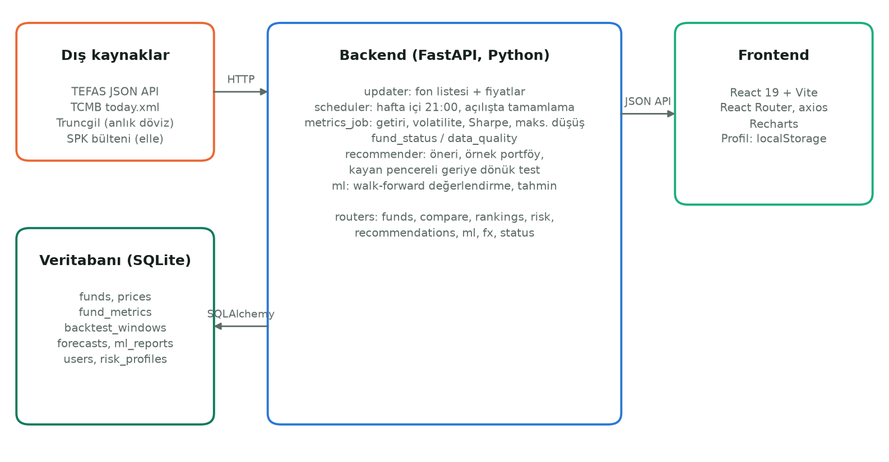

# 1. Hazırlık ve Tasarım

## 1.1 Amaç

TEFAS'ta binden fazla yatırım fonu işlem görmektedir. Fonların resmî sayfalarında fiyat ve dönem getirileri bulunsa da fonları risk açısından karşılaştırmak, düşüş dönemlerindeki davranışlarını görmek ve kişinin vadesi ile kayıp toleransına uygun fonu seçmek bireysel yatırımcı için zordur. Projenin amacı, bu süreci kolaylaştıran ve sonuçlarını şeffaf biçimde gerekçelendiren bir web uygulaması geliştirmektir. Uygulama yatırım tavsiyesi vermez; bütün öneriler eğitim amaçlıdır ve her sayfada bu uyarı yer alır.

## 1.2 Kapsam ve gereksinimler

**İşlevsel gereksinimler:**

- Fonları arama, kategori ve risk değerine göre süzme, metriklere göre sıralama.
- Fon detayında fiyat grafiği, dönem getirileri, risk metrikleri ve kategori içi sıra.
- En fazla dört fonun 100'den başlayan grafikle ve metrik tablosuyla karşılaştırılması.
- En yüksek getiri, en düşük volatilite ve en yüksek Sharpe oranına göre sıralamalar.
- Risk anketi, profile göre gerekçeli fon önerileri ve örnek portföy.
- Gelecek bir ay için getiri tahmini ve tahmin yönteminin performans sayfası.
- Döviz ve altın kurları.

Proje ilerledikçe eklenenler: fon detayında teknik göstergeler (50/200 günlük ortalama, trend, 52 haftalık aralık; Bölüm 4.4), fon büyüklüğü ve yatırımcı sayısı, hayali parayla çalışan sanal portföy ve "Ya o zaman alsaydım?" hesabı (Bölüm 3.6, 4.5).

**İşlevsel olmayan gereksinimler:**

- Türkçe arayüz, Türkçe sayı ve tarih biçimleri.
- Telefon genişliğinde (360–390 px) yatay taşma olmaması.
- Verinin her gün kendiliğinden güncellenmesi.
- Uygulamanın sunumda geliştiricinin kendi bilgisayarında, tek tıkla ve internet olmadan da çalışması; yayına alma kapsam dışıdır (bkz. Bölüm 7.4).
- Arayüzün erişilebilir olması: WCAG AA kontrastı, klavyeyle gezinme (Bölüm 4.3).

## 1.3 Yöntem ve araçlar

**Teknoloji.** Backend Python 3.13 ile FastAPI [1] ve SQLAlchemy 2.0 [2] üzerine kuruldu; veri işleme için pandas [3], zamanlanmış görevler için APScheduler kullanıldı. Veritabanı yerelde SQLite'tır. Frontend React 19 [4] ve Vite ile yazıldı; grafikler için Recharts [5] kullanıldı. Testler pytest ile, ön yüz kod denetimi ESLint ile yapıldı.

**Geliştirme süreci.** İşleri yedi aşamalı bir yol haritasına (`YOL_HARITASI.md`) böldük ve her aşamayı küçük, test edilebilir adımlarla ilerlettik. Her anlamlı adım ayrı bir git commit'i olarak kaydedildi; bu raporun geriye dönük bölümleri bu kayıtlara dayanmaktadır.

**Yapay zekâ araçlarının kullanımı.** Geliştirmede Anthropic'in Claude modelini ve komut satırı aracı Claude Code'u [6] kullandık. Kodun büyük bölümü, analiz betikleri ve bu raporun ilk taslakları Claude Code ile, bizim yönlendirmemizle yazıldı. Bu süreçte şu ilkeleri uyguladık:

- **Kararlar bize aittir.** Kapsam, yöntem ve tasarım kararlarını biz verdik. Örnekler: hedef değişkenin fiyat değil getiri olması, SPK kararıyla kapatılan fonların veriden silinmeyip işaretlenmesi, Sharpe için %5 volatilite eşiği, dengeli profilde riskli fon kotası, başarısız modelin tahminlerinin sitede gösterilmemesi, uygulamanın yayına alınmaması ve KAP'ın kullanım koşulu nedeniyle KAP verisinin hiç kullanılmaması. Claude seçenekleri, gerekçeleri ve veriden elde ettiği sayıları sundu; seçimi biz yaptık.
- **Çıktılar doğrulandı.** Her değişiklikten sonra otomatik testler (`pytest`; son durumda 131 test), ön yüz için `npm run lint` ve `npm run build` çalıştırıldı. Arayüz ayrıca gerçek tarayıcıda çalışan bir uçtan uca test betiğiyle sınandı (Bölüm 7.3). Veri iddiaları kaynağa karşı doğrulandı: TEFAS'tan yeniden çekilen fiyatlar veritabanıyla gün gün karşılaştırıldı, SPK kararı bülten ve haber kaynaklarıyla kontrol edildi.
- **Ölçümler gerçek ortamda yapıldı.** Arayüz değişiklikleri tarayıcıda ekran görüntüsü ve sayfa genişliği ölçümüyle kontrol edildi.
- **Hatalar kayıt altına alındı.** Yapay zekânın yaptığı hatalar düzeltilip commit geçmişine işlendi. Örnekler: bağımlılıkların yanlış dosyaya yazılması, Türkçe eklerin sayıya göre yanlış çekimlenmesi, doğrulanmamış bir literatür iddiası.
- **Raporun sayıları veriden geldi.** Bu rapordaki bütün sayılar veritabanından ve analiz betiklerinin çıktılarından alınmıştır; emin olunamayan yerler [DOLDUR] ile işaretlenmiştir.

## 1.4 Sistem mimarisi

Sistem dört parçadan oluşur (Şekil 1.1):

- **Dış kaynaklar:** TEFAS, TCMB ve anlık döviz kaynağı. SPK bülteni ise elle işlenir.
- **Backend (FastAPI):** Veri toplar, metrik hesaplar, öneri ve tahmin üretir, JSON API sunar.
- **SQLite veritabanı:** Bütün verinin ve hesaplanmış sonuçların tutulduğu yer.
- **Ön yüz (React):** Kullanıcının etkileşime girdiği tek sayfalık uygulama.

Hesaplaması uzun süren işler (metrikler, kayan pencereli geriye dönük test, ML değerlendirmesi) gece güncellemesinde önceden hesaplanıp tablolarda saklanır. Bu sayede API istekleri milisaniyeler içinde yanıtlanır.

## 1.5 Veritabanı tasarımı

İlk tasarımda beş tablo vardı: `funds` (fon bilgileri), `prices` (günlük fiyatlar), `portfolio_allocations` (varlık dağılımı), `users` ve `risk_profiles`. Proje ilerledikçe şu tablolar eklendi:

- `fund_metrics`: önceden hesaplanmış metrikler.
- `backtest_windows`: kayan pencereli test sonuçları.
- `forecasts`: günlük tahminler.
- `ml_reports`: ML değerlendirme raporları.

- `sanal_portfoy`, `sanal_emirler`, `sanal_degerler`: sanal portföyün ayarı, emirleri ve günlük değeri (Bölüm 3.6).
- `fx_snapshots`: döviz kaynaklarının son başarılı yanıtı; internet yokken son bilinen kurlar buradan gösterilir (Bölüm 7.4).

`funds` tablosuna SPK kararları için `status`, `status_note`, `status_source` ve `status_url`; TEFAS'tan gelen güncel bilgiler için `total_value`, `investor_count`, `info_date`, `kap_url`, `buy_valor`, `sell_valor`, `cutoff_time` ve `profile_date` alanları eklendi.

Henüz bir migration aracına (Alembic) geçmediğimiz için, mevcut tablolara sonradan eklenen boş bırakılabilir sütunları açılışta ekleyen küçük bir yardımcı (`init_db`) yazdık. Böylece yerel veritabanı silinip yeniden yüklenmeden şema güncellenebildi.

`portfolio_allocations` tablosu, TEFAS'ın portföy dağılımı yayımlamayı bırakması nedeniyle şu an boştur (bkz. Bölüm 2.2). `users` ve `risk_profiles` tabloları da kullanıcı girişi kapsam dışı kaldığı için kullanılmamaktadır; risk profili tarayıcıda saklanır.

## 1.6 Arayüz taslakları

[DOLDUR: Ana sayfa, fon detayı, karşılaştırma ve risk anketi için hazırlanan taslakların açıklaması ve görselleri; hangi araçla hazırlandığı.]

## 1.7 Proje takvimi

Git kayıtlarına göre kodlama 11.10.2026'da proje iskeletiyle başladı; veri toplama aynı gün, metrikler ve ön yüz sayfaları 13.10.2026'da, risk anketi ve öneri sistemi 13.10.2026'da, makine öğrenmesi modülü 14.10.2026'da tamamlandı. Aynı gün uygulamanın yayına alınmama kararını aldık; raporu ve rapor üretme betiğini hazırladık; KAP fizibilite denemesini ve veri kaynaklarının kullanım koşulları incelemesini yaptık (Bölüm 2.8 ve 2.9). 15.10.2026'da teknik göstergeler, fon büyüklüğü ve KAP bağlantısı, arayüz tasarımı ve koyu tema, sanal portföy ve sunum hazırlığı (tek tıkla başlatma, internetsiz çalışma, yedek, uçtan uca test) tamamlandı. [DOLDUR: Git kaydından önceki hazırlık süreci (proje fikri, tanıtım yazısı, mimari diyagram, taslaklar) ve tarihleri.]

## 1.8 Kısıtlar

- Uygulama tek kullanıcılı ve yereldir; kullanıcı girişi, favori fonlar ve yayına alma kapsam dışıdır.
- SQLite tek dosyalık bir veritabanıdır; çok kullanıcılı bir ortamda PostgreSQL gerekir (Gelecek çalışmalar).
- Gece güncellemesi yalnızca backend açıkken çalışır; bilgisayar kapalıyken kaçırılan günler bir sonraki açılışta otomatik tamamlanır.
