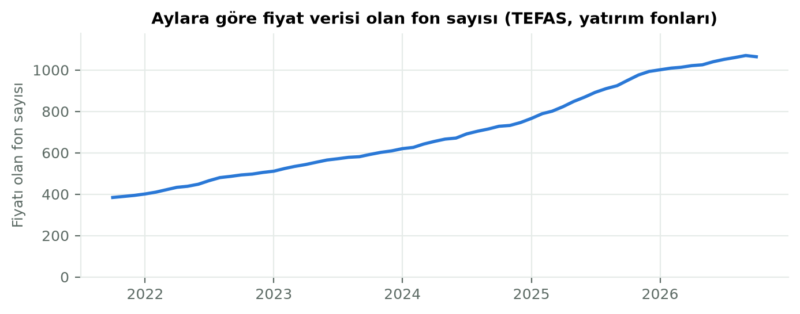
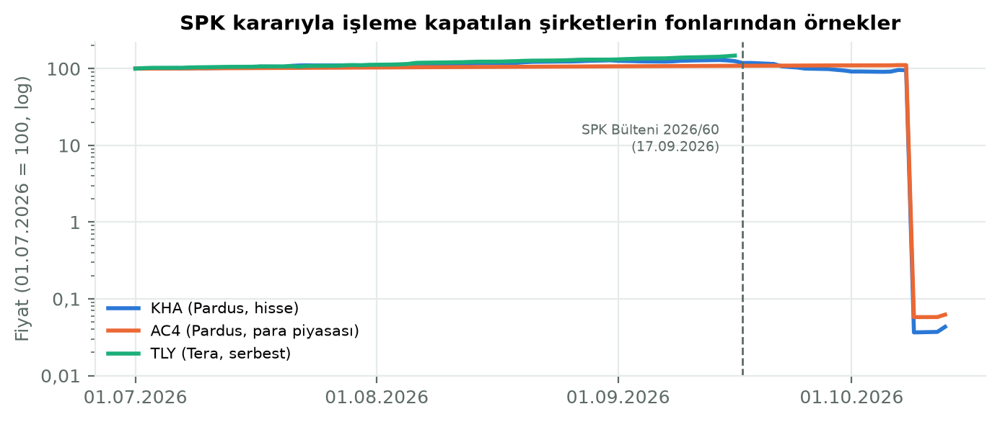

# 2. Veri Toplama

## 2.1 Amaç

Bu aşamanın amacı, TEFAS'taki yatırım fonlarının bilgilerini ve beş yıllık günlük fiyat geçmişini güvenilir biçimde toplamak, her gün kendiliğinden güncellemek ve verinin doğruluğunu kaynağa karşı doğrulamaktır.

## 2.2 TEFAS'ın 2026 arayüz değişikliği

TEFAS [7] 2026'da veri sunma biçimini değiştirdi. Eski HTML/form tabanlı uç noktalar yerine sitenin kendi kullandığı JSON uç noktaları üzerinden çalıştık (`app/services/tefas_client.py`):

- `/api/funds/fonGetiriBazliBilgiGetir`: fon listesi; kod, unvan, kategori, risk değeri ve işlem durumu.
- `/api/funds/fonFiyatBilgiGetir`: bir fonun fiyat geçmişi.
- `/api/funds/fonBilgiGetir`: bir fonun o günkü portföy büyüklüğü, yatırımcı sayısı ve pay adedi.
- `/api/funds/fonProfilBilgiGetir`: bir fonun profili; ISIN, valör, giriş/çıkış komisyonu ve fonun KAP sayfasının bağlantısı (`kapLink`). Profilden yalnızca bu bağlantıyı saklıyoruz.

Değişikliğin bizi doğrudan etkileyen sonuçları:

- **Kaldırılan ve kısıtlanan alanlar:** Portföy dağılımı artık yayımlanmıyor; varlık dağılımı özelliği uygulanmadı (Bölüm 2.8). Fon büyüklüğü ve yatırımcı sayısı yalnızca **güncel değer** olarak, fon başına ayrı bir istekle (`fonBilgiGetir`) alınabiliyor; geçmiş tarihlerin değerini veren bir uç nokta yok. Başta bu alanların tamamen kaldırıldığını düşünmüştük; 15.10.2026'da sitenin fon sayfasının kullandığı uç noktaları incelerken `fonBilgiGetir`'i bulduk. Bu nedenle yalnızca son alınan değeri `funds` tablosunda saklıyoruz (`total_value`, `investor_count`, `info_date`).
- **Sınırlı fiyat geçmişi:** En fazla 60 ay geriye gidiyor ve dönem parametresi yalnızca 1, 3, 6, 12, 36 ve 60 ay olabiliyor. İstemci, istenen süreyi bunlardan en yakın büyüğüne yuvarlıyor.
- **Resmî olmayan erişim:** Uç noktalar resmî ve belgelenmiş bir API değil, sitenin kullandığı adresler; TEFAS dışarıya API sunmadığını belirtmektedir (Bölüm 2.9). Siteyi yormamak için istekler arasında 0,5 saniye bekliyor, hata durumunda üç kez ve artan aralıklarla yeniden deniyoruz.

## 2.3 Veri yükleme ve günlük güncelleme

**İlk yükleme.** `scripts/tefas_yukle` betiği fon listesini ve her fonun son beş yıllık fiyatlarını yükler. Aynı fiyat iki kez yazılmaz, yalnızca eksik tarihler eklenir. Bütün fonların ilk yüklemesi yaklaşık 15 dakika sürmektedir.

**Günlük güncelleme.** `app/scheduler.py` hafta içi her gün saat 21:00'de (İstanbul) son bir ayın fiyatlarını çeker. Ardından sırasıyla şunları çalıştırır:

- her fon için güncel büyüklük ve yatırımcı sayısının alınması, KAP bağlantısı henüz yoksa onun da alınması (fon başına bir istek, KAP bağlantısı için bir kez daha; istekler arası bekleme korunur. Güncellemeye yaklaşık 9 dakika ekler; 1.071 fonun ilk doldurması `scripts/fon_bilgisi_yukle` ile 18 dakika sürdü ve hatasız tamamlandı),
- metriklerin yeniden hesaplanması (Bölüm 3),
- SPK kararlarına göre fon durumlarının işaretlenmesi,
- kayan pencereli geriye dönük test (Bölüm 5),
- tahmin işi (Bölüm 6).

TEFAS günün fiyatlarını akşam yayımladığı için daha erken bir saat seçmedik.

**Kaçırılan günler.** Bilgisayar 21:00'de kapalıysa güncelleme kaçar. Bu nedenle backend her açılışta verinin beklenen son tarihe ulaşıp ulaşmadığına bakar ve gerekirse güncellemeyi hemen başlatır.

## 2.4 Veri kapsamı

| | |
|---|---|
| Fon (yatırım fonu, YAT) | 1.071 |
| Günlük fiyat kaydı | 866.841 |
| Tarih aralığı | 13.10.2021 – 14.10.2026 |
| Kategori | 9 |
| TEFAS risk değeri boş olan fon | 118 |

Emeklilik (EMK) ve borsa yatırım fonları (BYF) TEFAS listesinde yer alıyor; 3 tür birlikte 1.419 fon. Ancak proje kapsamında yalnızca yatırım fonlarını yükledik. Fon sayısı zamanla artmaktadır (Şekil 2.1); yeni fonların geçmişi kısa olduğundan bir yıllık metrikler yalnızca en az bir yıllık verisi olan fonlar için hesaplanabilmektedir.

## 2.5 Döviz ve altın kurları

Döviz ve altın sayfası için iki kaynak kullandık:

- **TCMB'nin günlük gösterge kurları (`today.xml`) [8]:** Resmî kaynak.
- **Truncgil Finans [9]:** Gün içi anlık kurlar. Resmî olmayan bir kaynak olduğu için arayüzde ayrı bir sekmede, kaynağı belirtilerek gösterilmektedir.

## 2.6 Veri doğrulama

Toplanan verinin doğruluğunu iki yolla kontrol ettik:

- **Elle kontrol:** 5 fonun fiyatlarını TEFAS sitesiyle karşılaştırdık; hepsi birebir eşleşti. [DOLDUR: kontrol edilen 5 fonun kodları ve tarihleri.]
- **Programla kontrol:** Şüpheli görünen fonların fiyatlarını TEFAS'tan yeniden çekip veritabanıyla gün gün karşılaştırdık. Bütün kontrollerde fark sıfır çıktı:

| Fon | Karşılaştırılan gün | Fark |
|---|---|---|
| TLY | 1.239 | 0 |
| YCK | 1.229 | 0 |
| DLZ | 477 | 0 |
| KHA, AC4, BPZ | 22 (son 1 ay) | 0 |

Bu kontroller, aşağıda anlatılan olağan dışı fiyat hareketlerinin yükleme hatasından değil, kaynağın kendisinden geldiğini göstermiştir.

## 2.7 Veri kalitesi: sıçramalar ve SPK kararı

**Şüpheli sıçramalar.** `scripts/veri_kalitesi` betiği, bir işlem gününden diğerine fiyatı %30'dan fazla değişen günleri listeler. Ertesi gün eski düzeye dönen sıçramaları "tek günlük hata" olarak ayırır. 1.071 fonun 41'inde toplam 64 sıçrama bulduk:

- **Tek günlük hata:** 4 sıçrama (YCK ve BFS fonlarında birer giriş-dönüş çifti).
- **Kalıcı sıçrama:** 60.

Kararımız, **fiyat verisini değiştirmemek** oldu. Tek günlük hatalı fiyatlar yalnızca metrik hesabında yok sayılmaktadır (`data_quality.drop_one_day_glitches`). Örneğin BFS fonunda bu temizlik, 1 yıllık volatiliteyi %87,3'ten %21,8'e, maksimum düşüşü −%35,8'den −%18,3'e indirmiştir.

**SPK kararı.** Kalıcı sıçramaların 17'si aynı gün, 09.10.2026'da gerçekleşmişti: Pardus, A1 Capital ve Bulls Portföy fonları %95–100 değer kaybetmişti. Bunların arasında, ekonomik olarak bu kadar değer kaybedemeyecek para piyasası fonları da vardı. Araştırmamız sonucunda nedeni belirledik: SPK'nın 17.09.2026 tarihli 2026/60 sayılı bülteniyle [10] Tera, Pusula, Hedef, Atlas, A1, Pardus ve Bulls Portföy'ün TEFAS'taki bütün fonları alım satıma kapatılmış ve bültende unvanı sayılan fonların tasfiyesine karar verilmişti [11], [12].

Bu karar üzerine şunları yaptık:

- **İki kararı ayrı ele aldık.** Haberlerde kararın tamamı "işleme kapatma ve tasfiye" olarak özetleniyordu. Oysa bülten metnine göre işleme kapatma bütün fonları, tasfiye ise yalnızca listelenen fonları kapsıyor. Bu yüzden iki ayrı durum tanımladık:
  - `islem_kapali`: Veritabanındaki 71 fon.
  - `islem_kapali_tasfiye`: Tasfiye listesinde unvanı geçen 46 fon.
- **Eşleştirmeyi doğruladık.** Fonları unvanlarına göre işaretleyen `scripts/fon_durumu_isaretle` betiğini yazdık. 09.10.2026'da düşen 17 fonun hepsi tasfiye listesinde çıktı; bu, eşleştirmenin doğruluğunu destekledi. Unvanı listedekinden yalnızca "(TL)" ekiyle ayrılan bir fonu (KSA) emin olamadığımız için yalnızca "işleme kapalı" saydık.
- **TEFAS'ın durum alanı kullanılamadı.** TEFAS'ın fon listesindeki işlem durumu alanı (`tefasDurum`), bu 117 fonun hepsi için "işlemde" dönüyordu. Yani durumu TEFAS'tan otomatik olarak alamıyoruz; işaretleme unvana göre yapılıyor.
- **Etkisi:** İşaretli fonlar listede varsayılan olarak gizlenir; sıralamalara, risksiz getiri hesabına ve önerilere girmez. Detay sayfalarında SPK bültenine bağlantılı bir uyarı gösterilir.

**Eski verili fonlar.** Son fiyatı en güncel tarihten 7 günden eski olan fonlar (13.10.2026 itibarıyla 8 fon, ör. TLY) "eski verili" sayılır ve aynı şekilde varsayılan görünümlerden çıkarılır.

## 2.8 Portföy dağılımı ve KAP

TEFAS portföy dağılımını yayımlamayı bıraktığı için fonların varlık dağılımını gösteremiyorduk. Alternatif kaynak olarak Kamuyu Aydınlatma Platformu'nda (KAP) [13] yayımlanan "Portföy Dağılım Raporu" bildirimlerini değerlendirdik. Fizibilite denemesini 14.10.2026'da yaptık ve süreyi en fazla iki saatle sınırladık.

**Erişim.** KAP'ın resmî ve belgelenmiş bir API'sini bulamadık. Denemede, TEFAS'ta olduğu gibi sitenin kendi kullandığı adresleri kullandık ve istekler arasında en az bir saniye bekledik:

- **Fon listesi:** 2.145 yatırım fonunu, TEFAS kodlarıyla birlikte veriyor.
- **Bildirim sorgusu:** Tarih aralığı ve fon türüyle sorgulanıyor. Sonuçlar 2.000 kayıtta kesiliyor; bütün yatırım fonları için bu, yaklaşık iki günlük bildirime denk geldi.
- **Ek dosyalar:** PDF olarak bildirilen dosyalar, başına 27 baytlık bir Java nesne başlığı eklenmiş biçimde iniyor; başlık atılınca geçerli PDF elde ediliyor.

Bu adresler belgelenmemiştir, önceden haber verilmeden değişebilir. Denemenin sonunda KAP'ın güvenlik duvarı bağlantıyı kesmeye başladı.

**Örneklem ve sonuç.** 12–14.10.2026 arasında yayımlanan 391 portföy dağılım raporundan, 15 farklı portföy yönetim şirketinden birer raporu rastgele seçtik (seçim tohumu sabit). Her raporda varlık sınıflarını ve yüzdelerini, yazının sayfadaki konumuna göre çıkardık. Çıkarımın doğruluğunu, yüzdelerin toplamının %100 olup olmadığıyla sınadık.

**Tablo 2.1** KAP portföy dağılım raporu örneklemi

| Fon | Şirket | Dönem | Biçim | Kalıp | Yüzde toplamı |
|---|---|---|---|---|---|
| HVT | Allbatross | Eylül 2026 | Metinli PDF | A: harfli form | %100,0 |
| OUD | Osmanlı | 40. hafta | Metinli PDF | A | %100,0 |
| DKR | Deniz | 40. hafta | Metinli PDF | A | %100,0 |
| BHE | Ak | 40. hafta | Metinli PDF | A | %100,0 |
| IAR | İstanbul | 40. hafta | Metinli PDF (2 ek) | A | %100,0 |
| FDV | Azimut | 40. hafta | Metinli PDF | A | %100,0 |
| ICV | TEB | 40. hafta | Metinli PDF (Excel'den) | A | %100,0 |
| PKP | Ata | 40. hafta | Metinli PDF | B: "Kalem : %x" listesi | %100,0 |
| RIA | Rota | 40. hafta | Metinli PDF (Excel'den) | B | %100,0 |
| PJP | Perform | 40. hafta | Metinli PDF | B | %99,99 (bir ara toplam satırı dışlanınca) |
| ZCD | Ziraat | 40. hafta | Düz metin PDF | C: sabit genişlikli metin | %100,0 |
| YBH | Yapı Kredi | 40. hafta | Metinli PDF | Kendine özgü (etiket ve değer ayrı satırlarda) | Çıkarılamadı |
| IOG | İş | 40. hafta | Metin katmanı olmayan PDF (yazılar çizim olarak) | OCR gerekir | Çıkarılamadı |
| NKH | Neo | 40. hafta | Ek yok | Rapor yok | – |
| BIK | Bulls | 40. hafta | Ek yok | Rapor yok | – |

Örneklemde taranmış PDF ya da Excel eki çıkmadı; eklerin hepsi PDF'ti. Ek dosyası olmayan iki bildirimde, paylarını yalnızca nitelikli yatırımcılara satan fonların portföy dağılım raporu hazırlama yükümlülüğünden muaf olduğu belirtiliyordu [14].

Önceden belirlediğimiz karar ölçütü şuydu: raporların en az %70'i üç ya da daha az kalıba indirgenebilmeli ve bunlardan varlık sınıfları ile yüzdeler güvenilir biçimde çıkarılabilmelidir. 15 raporun 11'i (%73) üç kalıba indirgendi ve yüzde toplamları tuttu; yani teknik ölçüt sınırda karşılandı. Ancak bu oran iyimser olabilir:

- **Örneklem dar bir dönemden geldi.** 2.000 kayıt sınırı nedeniyle örneklem iki günlük bir pencereden alındı; raporların çoğu haftalık serbest fon raporuydu.
- **Kalıpların zaman içinde sabit kalıp kalmadığı sınanmadı.** Her şirketten yalnızca bir rapora bakıldı.
- **Kapsam fon sayısına göre daha düşük olabilir.** Kalıplara girmeyen İş ve Yapı Kredi, en çok fonu olan şirketler arasındadır.

**Kullanım koşulu.** KAP'ın "Telif Hakkı ve Çekince İhbarı" metni şöyledir [15]:

> "Kullanıcılar bilgi ve dokümanları, sadece bilgi edinme amacıyla kullanabilir. Burada mevcut bulunan bilgiler, MKK'nın önceden yazılı olarak izni alınmadan kısmen veya tamamen kopya edilemez, uygulamaya konulamaz, dağıtılamaz, kiralanamaz, çoğaltılamaz, alt lisansla kullandırılamaz, değiştirilemez, ileride kullanılmak üzere saklanamaz."

**Karar.** Portföy dağılımı özelliğini **uygulamadık**. Teknik ölçüt sınırda karşılansa da, raporlardan çıkarılan verileri veritabanında saklamak bu koşuldaki "ileride kullanılmak üzere saklanamaz" yasağına doğrudan girmektedir. Aynı gerekçeyle KAP bildirimlerini (başlık, tarih, tür) çekip saklama ve uygulamada gösterme planından da vazgeçtik. Uygulama hiçbir KAP verisini saklamaz ve göstermez. Fon detay sayfasında yalnızca fonun KAP sayfasına giden bir bağlantı vardır.

**KAP bağlantısı nereden geliyor?** KAP'ta bir fonun sayfasının adresi fon kodunu değil, KAP'ın kendi adlandırmasını içerir; bu adres KAP'tan veri çekmeden tahmin edilemez. İlk sürümde bu yüzden bağlantı KAP'ın yatırım fonları listesine gidiyordu ve kullanıcı fonu orada arıyordu. Daha sonra TEFAS'ın fon profilinin (`fonProfilBilgiGetir`) her fon için KAP sayfasının adresini (`kapLink`) verdiğini gördük. Bu adres KAP'ın değil TEFAS'ın verisidir; KAP'tan hiçbir şey çekmeden yalnızca bu bağlantıyı saklıyoruz (`funds.kap_url`). Bağlantıyı, KAP'ın alan adıyla (`https://www.kap.org.tr/`) başlamıyorsa saklamıyoruz. Bağlantısı olmayan fonlarda eski davranış (KAP'ın fon listesi) sürer. 15.10.2026 itibarıyla veritabanındaki 1.071 fonun tamamının KAP bağlantısı vardır. Fizibilite denemesi sırasında indirilen dosyalar yalnızca geçici çalışma klasöründe tutuldu, projeye eklenmedi.

MKK'dan yazılı izin alınması durumunda A, B ve C kalıpları için bir ayrıştırıcı yazılabilir; bu, gelecek çalışmalara bırakılmıştır (Bölüm 8.4).

## 2.9 Kaynakların kullanım koşulları

KAP'taki kısıtı gördükten sonra aynı kontrolü bütün veri kaynaklarımız için yaptık (14.10.2026). Her kaynağın kullanım koşulunu aradık ve verinin saklanması ve uygulamada gösterilmesi hakkında ne dediğine baktık.

**TCMB.** Kullanım Şartları metni [16] şöyledir:

> "TCMB internet sitesi, hiçbir kişi ve/veya kuruluşa herhangi bir konuda herhangi bir taahhüdü içermemektedir. Sitede yer alan bilgiler, kaynak gösterilmek suretiyle yayımlanabilir; ancak bu bilgilerin ticari amaçlarla kullanımı TCMB'nin yazılı iznine tabidir."
>
> "Site içerisindeki bilgilerin bir kısmı doğrudan, bir kısmı da diğer kaynaklardan sağlanarak TCMB tarafından yayınlanmakta olup, telif hakkı ve diğer her türlü hakkı TCMB'ye aittir."

Bilgiler kaynak gösterilerek yayımlanabilir; yalnızca ticari kullanım yazılı izne bağlıdır. Saklama hakkında bir hüküm yoktur. Projemiz ticari değildir ve döviz sayfasında kaynak belirtilmektedir.

**TEFAS (Takasbank).** Sitede ayrı bir kullanım koşulları sayfası bulamadık; alt menüde yalnızca kişisel verilerin korunması ve çerez metinleri vardır. Bağlayıcı metin, her sayfada yer alan "Çekince Bildirimi"dir [17]:

> "Bu sitede yer alan içeriklerin bir kısmı Takasbank'tan, bir kısmı ise diğer kaynaklardan sağlanarak Takasbank tarafından yayınlanmaktadır. Burada yer alan yatırım bilgi, yorum ve tavsiyeleri yatırım danışmanlığı kapsamında değildir. […] Takasbank, bu sitede yer alan bilgilerin; doğru, yeterli, eksiksiz ve güncel olduğunu garanti etmemektedir. […] Bu sitede yer alan bilgileri kullananlar; bilgilerdeki virüs, eksiklik ve/veya hatalardan dolayı Takasbank'ın sorumlu olmadığını kabul ederler."

Sıkça sorulan sorularda API ile erişim sorusuna verilen cevap ise şöyledir [18]:

> "TEFAS Fon Bilgilendirme Platformu'nda yer alan veriler, çekince bildirimi kapsamında finsansal okur yazarlığın artırılması amacıyla paylaşılmaktadır. Bu kapsamda API paylaşımı yapılmamaktadır. Bununla birlikte; Borsa İstanbul tarafından dağıtımı yapılan verilere ilişkin olarak Borsamız "Pazarlama ve Satış Direktörlüğü"nün ilgili birimiyle (vyk-marketing@borsaistanbul.com) adresi üzerinden iletişime geçebilirsiniz."

Saklamayı ya da göstermeyi yasaklayan bir hüküm yoktur. Ancak TEFAS dışarıya API sunmadığını açıkça belirtmektedir. Kullandığımız JSON adresleri sitenin kendi iç adresleridir; bu kullanım ne izinli ne de yasak olarak tanımlanmıştır. Verilerin paylaşılma amacının "finansal okuryazarlığın artırılması" olarak tanımlanması, projemizin eğitim amacıyla uyumludur.

**Truncgil Finans.** Hiçbir kullanım koşulu bulamadık. Ürün sayfasındaki "Terms of Use" ve "Privacy Policy" bağlantıları boştur. API belgesinde [19] lisans ya da koşul alanı yoktur; tek kısıt, bir uç nokta için belirtilen "30 saniyede 2 istek" sınırıdır. Ürün sayfasında API'nin anahtarsız ve açık olduğu belirtilmektedir. Kullanımı kısıtlayan bir metin yoktur, ama açık bir izin de verilmemiştir. Kaynak, verinin doğruluğu için de hiçbir taahhütte bulunmamaktadır. Bu nedenle bu kurlar arayüzde resmî TCMB kurlarından ayrı bir sekmede, kaynağı belirtilerek gösterilmektedir.

**Tablo 2.2** Veri kaynaklarının kullanım koşulları

| Kaynak | Göstermek | Saklamak | Not | Projedeki kullanım |
|---|---|---|---|---|
| KAP | MKK'nın yazılı izni gerekli | Açıkça yasak | Resmî API yok | Kullanılmıyor; yalnızca bağlantı |
| TCMB | Kaynak göstererek serbest | Hüküm yok | Ticari kullanım yazılı izne bağlı | Gösterge kurları, kaynak belirtilerek |
| TEFAS | Açık yasak yok | Açık yasak yok | Dış API sunulmuyor; iç adresler kullanılıyor | Fon listesi, fiyatlar, güncel büyüklük ve yatırımcı sayısı, KAP bağlantısı |
| Truncgil | Koşul yok | Koşul yok | Hiçbir taahhüt yok | Anlık kurlar, ayrı sekmede |

**Yönetim ücreti.** Fonların yıllık yönetim ücretini göstermek için kaynak aradık (15.10.2026). TEFAS'ın sayfalarında (fon karşılaştırma, terimler sözlüğü, sıkça sorulan sorular) ve fon sayfasının kullandığı uç noktalarda (`fonBilgiGetir`, `fonProfilBilgiGetir`) yönetim ücreti alanı yoktur; profil yalnızca giriş ve çıkış komisyonunu verir. Yönetim ücreti resmî olarak fon izahnamesinde ve KAP'ta yayımlanır; KAP verisini kullanmadığımız için (Bölüm 2.8) bu özelliği kapsam dışı bıraktık (Bölüm 8.4). Getiri hesaplarımız bundan etkilenmez, çünkü yönetim ücreti fon fiyatına zaten yansımıştır.

**Değerlendirme.** Bu inceleme sonucunda kod değişikliği yapmadık. KAP dışındaki kaynaklarda kullanımımızı açıkça yasaklayan bir hüküm bulunmamaktadır. Ancak TEFAS ve Truncgil erişimi açık bir izne değil, yasak bulunmamasına dayanmaktadır. Uygulama yayına alınacak ya da ticari amaçla kullanılacak olursa TEFAS verisi için Borsa İstanbul'un veri yayın ürünleri, KAP verisi için MKK'nın yazılı izni gerekecektir.

## 2.10 Kısıtlar

- TEFAS erişimi resmî bir API'ye değil, sitenin kendi kullandığı adreslere dayanır; TEFAS dışarıya API sunmadığını belirtmektedir (Bölüm 2.9). Bu adresler önceden haber verilmeden değişebilir. Truncgil'in kullanım koşulu yoktur.
- Fiyat geçmişi beş yılla sınırlıdır.
- Fonların kategori ve risk değerinin geçmişteki hâlleri saklanmamaktadır; yalnızca güncel değerler bilinmektedir.
- Fon büyüklüğü ve yatırımcı sayısının geçmişi yoktur; TEFAS yalnızca güncel değeri verir. Bu yüzden bu bilgiler öneri algoritmasında ve geriye dönük testte kullanılmaz (Bölüm 5.8).
- Yönetim ücreti gösterilmemektedir; TEFAS'ta bulunmamaktadır (Bölüm 2.9).
- SPK kararları elle izlenmekte ve işlenmektedir.
- Fonların portföy dağılımı gösterilmemektedir; KAP verisi kullanım koşulu nedeniyle saklanmamaktadır (Bölüm 2.8).
