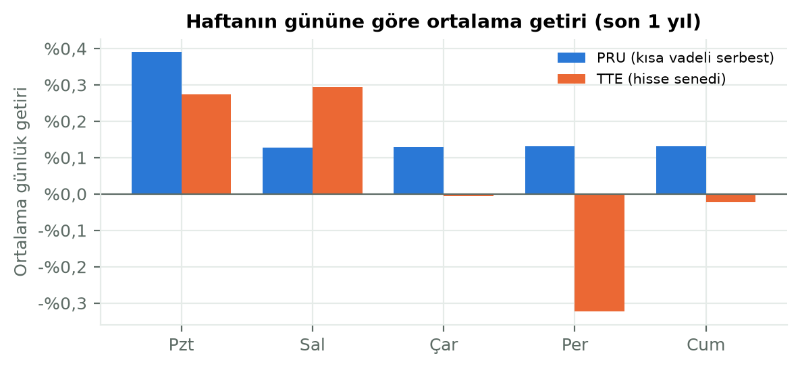
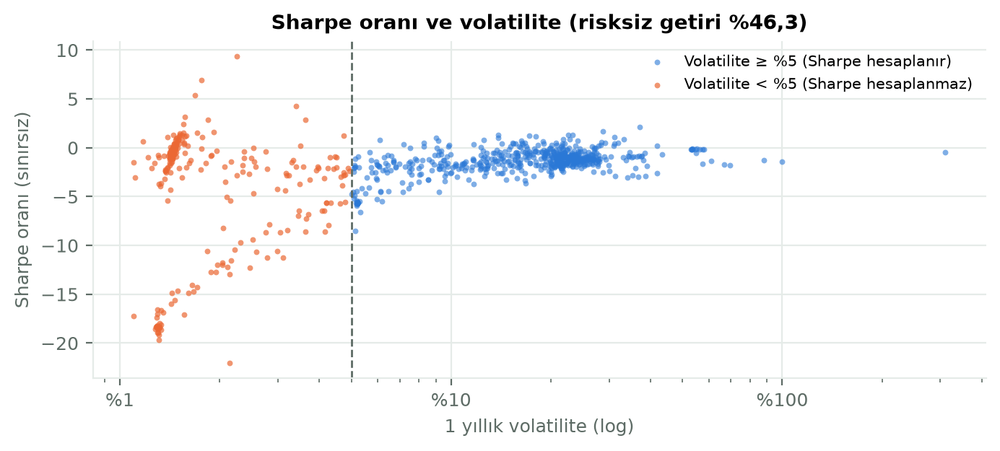

# 3. Backend ve Metrikler

## 3.1 Amaç

Bu aşamada, toplanan fiyatlardan fonların performans ve risk metriklerini hesaplayan, sonuçları önceden hesaplayıp saklayan ve ön yüze hızlı bir JSON API sunan backend katmanını geliştirdik.

## 3.2 API

FastAPI [1] ile şu uç noktaları sunduk (`app/routers/`):

| Uç nokta | İşlev |
|---|---|
| `GET /api/funds` | Fon listesi: arama (Türkçe büyük harf duyarlı), kategori ve risk süzgeci, metriğe, fon büyüklüğüne ya da yatırımcı sayısına göre sıralama, sayfalama |
| `GET /api/funds/categories` | Kategoriler ve fon sayıları |
| `GET /api/funds/{kod}` | Fon detayı, metrikler, kategori içi sıra, SPK durumu, güncel büyüklük ve yatırımcı sayısı, KAP bağlantısı |
| `GET /api/funds/{kod}/prices` | Fiyat geçmişi (ay sayısı ya da tarih aralığı) |
| `GET /api/funds/{kod}/technical` | 50/200 günlük hareketli ortalama, trend, 52 haftalık aralık (Bölüm 4.4) |
| `GET /api/compare` | 2–4 fonun 100'den başlayan karşılaştırma serileri |
| `GET /api/rankings` | En yüksek getiri, en düşük volatilite, en yüksek Sharpe |
| `GET /api/risk-survey`, `POST /api/risk-profile` | Risk anketi ve profil (Bölüm 5) |
| `GET /api/recommendations`, `…/backtest` | Öneriler, örnek portföy, kayan pencereli test (Bölüm 5) |
| `GET /api/funds/{kod}/forecast`, `GET /api/ml/performance` | Tahmin ve model performansı (Bölüm 6) |
| `GET /api/sanal-portfoy`, `POST …/emir`, `DELETE …/emir/{id}`, `POST …/sifirla` | Sanal portföy: özet, alış/satış emri, bekleyen emri iptal, sıfırlama (Bölüm 3.6) |
| `GET /api/sanal-portfoy/geriye` | "Ya o zaman alsaydım?": en fazla 4 fon, tarih ve tutar (Bölüm 3.6) |
| `GET /api/fx`, `GET /api/status` | Döviz kurları, veri durumu |

Fon adları TEFAS'ta Türkçe büyük harfle tutulduğu ve SQLite'ın büyük-küçük harf eşleştirmesi Türkçe harfleri (İ, I, Ş, Ğ) tanımadığı için arama terimini Türkçe kurallarla büyük harfe çeviren bir yardımcı (`tr_upper`) yazdık.

## 3.3 Metrikler

Bütün oranlar ondalık kesir olarak saklanır (0,25 = %25). Tanımlar (`app/services/metrics.py`):

| Metrik | Tanım |
|---|---|
| Dönem getirisi (1, 3, 6 ay, 1 yıl, 3 yıl) | Son fiyat / dönem başındaki (ya da öncesindeki son) fiyat − 1; dönem başında 7 günden eski fiyat varsa hesaplanmaz |
| Yılbaşından bu yana | Son fiyat / önceki yılın son fiyatı − 1 |
| Volatilite (1 yıl) | Günlük getirilerin standart sapması × √252 |
| Sharpe oranı (1 yıl) [20] | (1 yıllık getiri − risksiz getiri) / 1 yıllık volatilite |
| Maksimum düşüş (1 yıl) | Bir zirveden sonraki en büyük yüzde kayıp |

3 yıllık getiri yıllıklandırılmadan, toplam getiri olarak gösterilir. Metrikler her gece bütün fonlar için yeniden hesaplanıp `fund_metrics` tablosuna yazılır. Bu işlem 1.071 fon için yaklaşık 8,5 saniye sürmektedir. Bu sayede liste sayfası binden fazla fonun metriklerini veritabanından tek sorguyla okuyabilmektedir.

13.10.2026 itibarıyla metriklerin kapsamı:

| Metrik | Hesaplanabilen fon |
|---|---|
| 1 yıllık getiri | 933 |
| 3 yıllık getiri | 583 |
| Volatilite | 1.050 |
| Sharpe oranı | 651 |

Eksik değerler, fonun yeterli geçmişinin olmamasından kaynaklanır. Sharpe için ayrıca Bölüm 3.5'teki eşik devrededir.

**Risksiz getiri.** Sharpe oranı için risksiz getiri olarak para piyasası fonlarının 1 yıllık medyan getirisini kullandık. 13.10.2026 itibarıyla bu değer %46,3'tür. Hesaba yalnızca güncel verili ve SPK kararıyla kapatılmamış para piyasası fonları girer. Sabit bir faiz oranı yerine bu yöntemi seçmemizin nedeni, değerin veriden otomatik güncellenmesi ve yatırımcının fon dünyası içinde gerçekten elde edebileceği "risksiz" getiriyi temsil etmesidir.

## 3.4 Eski verili ve işleme kapatılan fonlar

Son fiyatı en güncel tarihten 7 günden eski olan fonların 1 yıllık getirisi başka bir döneme ait olduğu için diğer fonlarla karşılaştırılamaz. Bu fonlar ve SPK kararıyla işleme kapatılan fonlar (Bölüm 2.7) şunlardan çıkarılır:

- fon listesinin varsayılan görünümü (bir seçenekle gösterilebilirler),
- kategori fon sayıları ve kategori içi sıra,
- sıralamalar,
- risksiz getiri hesabı.

Bu kurallar API testleriyle doğrulanmıştır.

## 3.5 Karşılaşılan sorun: Sharpe oranı ve pazartesi etkisi

Sıralamalar sayfasında en yüksek Sharpe oranları gerçek dışı görünüyordu:

| Fon | Sharpe oranı |
|---|---|
| NBH | 9,35 |
| PRU | 6,95 |
| KKL | 5,35 |
| LPH | 4,25 |
| HVT | 3,15 |

**İlk hipotez yanlış çıktı.** İlk hipotezimiz, fiyatı seyrek güncellenen fonların yapay olarak düşük volatilite gösterdiğiydi. Bunu sınamak için her fonun son bir yılında fiyatın değişmediği günlerin oranını hesapladık. Sharpe sıralamasının ilk 10'unda bu oran %0'dı. Kapatılmış ve eski verili olanlar dahil 1.067 fonun hiçbirinde de %5'i aşmıyordu. Yani bu veride seyrek güncelleme sorunu yoktu.

**Asıl nedeni grafikler gösterdi.** Bu fonlar kısa vadeli, para piyasası ve borçlanma fon sepeti türünden fonlardı. Fiyatları neredeyse düz bir çizgi biçiminde artıyor, volatiliteleri %1,6–3,6 arasında kalıyordu. Haftanın günlerine göre getirilere baktığımızda belirleyici bulguya ulaştık (Şekil 3.1):

- **PRU'da pazartesi getirisi diğer günlerin yaklaşık üç katıydı:** Pazartesi %0,390, diğer günler %0,128–0,132. Hafta sonunun faizi pazartesi fiyatına yansıyordu.
- **Ölçülen volatilitenin büyük kısmı risk değil, bu takvim etkisiydi.** Getiriyi takvim günü başına çevirdiğimizde PRU'nun volatilitesi %1,77'den %0,20'ye düştü.
- **Sonuç:** Paydası neredeyse sıfır olan Sharpe oranı anlamsız büyüyordu. Örneğin PRU için (58,6 − 46,3) / 1,8 ≈ 6,9.

**Çözüm.** Volatilite dağılımına baktık: fonların %10'unun volatilitesi %1,4'ün altında, ilk çeyreğin sınırı %3,1, medyan %13,3. Para piyasası benzeri fonlar ayrı bir küme oluşturuyordu (Şekil 3.2). Farklı eşikleri karşılaştırdık:

- **%3:** Yetersiz. LPH (4,25) ve IRF (2,84) zirvede kalıyordu.
- **%8 ve %10:** İlk 10'u değiştirmiyor, yalnızca daha fazla fonu dışarıda bırakıyordu.
- **%5:** Doğal kırılma noktası.

Bu yüzden **1 yıllık volatilitesi %5'in altındaki fonlarda Sharpe oranını hesaplamamaya** karar verdik. %5, SPK/ESMA risk göstergesi yönteminde 3. risk sınıfının üst sınırıdır [21].

- **Etkisi:** 318 fon Sharpe değeri almıyor. Bunların 164'ü serbest, 49'u katılım, 46'sı para piyasası fonu.
- **Arayüzde:** Bu fonlarda Sharpe yerine "volatilite çok düşük, Sharpe anlamlı değil" notu gösteriliyor.
- **Sonuç:** Eşikten sonra en yüksek Sharpe oranı 2,10'a (AES) indi; ilk 10 gerçek fiyat riski taşıyan fonlardan oluştu.

## 3.6 Sanal portföy

Kullanıcının hayali parayla fon alıp satarak deneme yapabildiği bir simülasyon ekledik (`app/services/sanal_portfoy.py`). Gerçek alım satım yapılmaz. Kullanıcı girişi olmadığı için tek bir portföy vardır ve yerel veritabanında saklanır. Üç tablo kullanılır: `sanal_portfoy` (başlangıç bakiyesi ve günü), `sanal_emirler` (bütün emirler) ve `sanal_degerler` (günlük portföy değeri). Tablolar açılışta `init_db()` ile oluşturulur.

**Defter yaklaşımı.** Nakit, pozisyonlar ve maliyet ayrıca saklanmaz; her seferinde emir kayıtlarından yeniden hesaplanır. Böylece bakiye ile işlemler arasında tutarsızlık oluşamaz. Maliyet ortalama maliyet yöntemiyle izlenir: kısmi satışta satılan payların maliyeti ortalama maliyetten düşülür, aradaki fark "gerçekleşen kâr/zarar" olur.

**TEFAS kurallarına yakın işlem.** Emirler hemen gerçekleşmez, bekleyen emir olarak kaydedilir:

1. *Emir günü.* Hafta sonu ya da fonun son işlem saatinden (TEFAS profilindeki `sonIsSaat`, ör. 17:45; para piyasası fonlarında 13:30) sonra verilen emir ertesi iş günü verilmiş sayılır.
2. *Valör.* Emir gününe fonun valörü kadar iş günü eklenir ve emir o günün fiyatından gerçekleşir. O gün tatilse (fiyat yoksa) sonraki ilk işlem gününün fiyatı kullanılır. Valör bilgisi olmayan fonlarda ertesi iş günü fiyatı kullanılır ve bu, emrin notunda yazar.
3. *İleri fiyat.* Hedef günün fiyatı emir verildiği anda zaten biliniyorsa (veritabanındaysa) emir bir sonraki iş gününe kayar. Böylece bilinen bir fiyattan işlem yapılamaz. Bu, gerçek fon işlemlerindeki "ileri fiyatlama" ilkesine karşılık gelir.
4. *Nakit ve pay.* Alış emrinde tutar emir verilince ayrılır (bloke); kullanılabilir nakitten fazla alış emri verilemez. Pay adedi tam sayıdır; tutarın 1 paya yetmeyen kısmı nakitte kalır. Satışta pay adedi girilir. Bekleyen satış emrindeki paylar yeniden satılamaz; satış tutarı nakde valör gününde geçer.
5. *Kısıtlar.* SPK kararıyla işleme kapatılan, TEFAS'ta işlem görmeyen ve eski verili (son fiyatı 7 günden eski) fonlar alınamaz. Komisyon, stopaj ve TEFAS'taki tutar/adet sınırları uygulanmaz.

Bekleyen emirler her gece güncellemeden sonra, ilgili günün fiyatı geldiğinde gerçekleşir. Aynı adımda portföyün başlangıç gününden son fiyat gününe kadar günlük değeri yeniden hesaplanır (`process()`). Fiyatlar metriklerdeki gibi tek günlük hatalardan arındırılır; veritabanındaki fiyat değiştirilmez.

**Valör alanlarının anlamı.** TEFAS profilinde iki alan vardır: `fonSatisValor` ve `fonGeriAlisValor`. Adlarına bakınca ilkinin yatırımcının alışı olduğu düşünülebilir. Ancak değerler bunun tersini gösterir. Yabancı hisse fonlarında (ör. GUH, AES) `fonGeriAlisValor` 1, `fonSatisValor` 3'tür; Türkiye'de bu fonlarda alım T+1, satım T+3 valörlüdür. Yurt içi hisse fonlarında değerler 1 ve 2'dir (alım T+1, satım T+2); para piyasası fonlarında ikisi de 0'dır. Bu nedenle alış valörü olarak `fonGeriAlisValor`'ü, satış valörü olarak `fonSatisValor`'ü kullandık. 15.10.2026'da 1.071 fonun profilini aldık: 1.065 fonun alış valörü vardır (142 fonda T+0, 923 fonda T+1); 6 fonda valör boştur ve bu fonlarda ertesi iş günü kuralı uygulanır. Satış valörlerinin dağılımı: T+0: 142, T+1: 159, T+2: 584, T+3: 177, T+4: 2 fon; 7 fonda boş. Profil 30 günde bir yenilenir.

**Kıyas.** Portföyün değeri, aynı başlangıç bakiyesinin portföyün başladığı gün para piyasası fonlarına (her gün, 100'den başlayan serilerin medyanı) yatırılmış olmasıyla kıyaslanır. Yöntem öneri sistemindeki kıyasla aynıdır (Bölüm 5).

**"Ya o zaman alsaydım?"** Geriye dönük modda kullanıcı en fazla 4 fon, bir tarih ve bir tutar seçer. Her fon, o tarihteki ya da sonraki ilk işlem günündeki fiyattan alınmış sayılır ve son fiyat gününe kadar tutulur. Bu modda pay kesirli kabul edilir, çünkü amaç fonları aynı tutarla karşılaştırmaktır. Sonuçta bugünkü değer, kâr/zarar (TL ve %), yıllıklandırılmış getiri ve aynı dönemde para piyasası medyanının getirisi gösterilir. Para piyasası kıyası her fon için o fonun kendi alış ve son fiyat günleri arasında hesaplanır; böylece seçilen tarihte henüz var olmayan ya da sonradan kapatılan bir fon da doğru dönemle kıyaslanır. Yıllıklandırma yalnızca yaklaşık 1 yıl (360 gün) ve daha uzun dönemlerde yapılır; daha kısa bir dönemi yıllığa çevirmek, tek bir iyi ayı yıllık %100'lerin üstünde göstererek yanıltıcı olurdu. SPK kararıyla kapatılan fonlar bu modda seçilebilir (geçmişte alınabiliyorlardı), ama sonuçta durumları belirtilir.

## 3.7 Testler

Backend'de toplam 125 otomatik test vardır (`backend/tests/`). Testler şu alanları kapsar:

- **Metrik tanımları:** Bilinen sentetik serilerle.
- **API davranışları:** Süzme, sıralama, sayfalama, Türkçe arama, eski verili ve kapatılmış fonların dışlanması.
- **Diğer kurallar:** Veri kalitesi ve SPK işaretleme.
- **Sanal portföy:** Emir günü ve son işlem saati, valör ve hafta sonu, ileri fiyat, tatil gününde sonraki fiyat, valör bilgisi olmayan fon, nakit yetersizliği (bekleyen alışlar dahil), kısmi ve tam satış ile ortalama maliyet, bekleyen satıştaki payların yeniden satılamaması, iptal, sıfırlama, kapatılmış ve eski verili fon, günlük değer ve para piyasası kıyası, "Ya o zaman alsaydım?" hesabı ve yıllıklandırma sınırı (18 test).
- **Diğer bölümler:** Öneri sistemi ve makine öğrenmesi modülü (Bölüm 5 ve 6).

Her değişiklikten sonra bütün testler çalıştırıldı.

## 3.8 Kısıtlar

- Fonların BIST 100, enflasyon ve mevduat ile kıyası ve beta katsayısı hesaplanmadı [DOLDUR: yapılırsa güncellenecek].
- Şema değişiklikleri bir migration aracıyla değil, açılışta eksik sütunları ekleyen bir yardımcıyla (`init_db`) yönetilmektedir; Alembic'e geçiş gelecek çalışmalara bırakıldı.
- Sanal portföy tek kullanıcılıdır ve bilgisayardaki veritabanında saklanır; komisyon, stopaj ve TEFAS'ın tutar/adet sınırları uygulanmaz. Resmî tatiller bilinmediği için valör günü hesabında yalnızca hafta sonları atlanır; tatile denk gelen hedef günde sonraki ilk işlem gününün fiyatı kullanılır.
- Metrikler basit getiriler üzerinden hesaplanmaktadır; vergi, giriş-çıkış komisyonu gibi maliyetler hesaba katılmamaktadır (fon yönetim ücreti fiyata yansımıştır).
