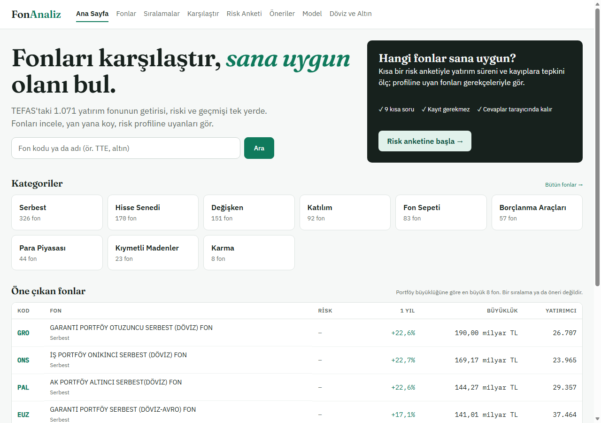
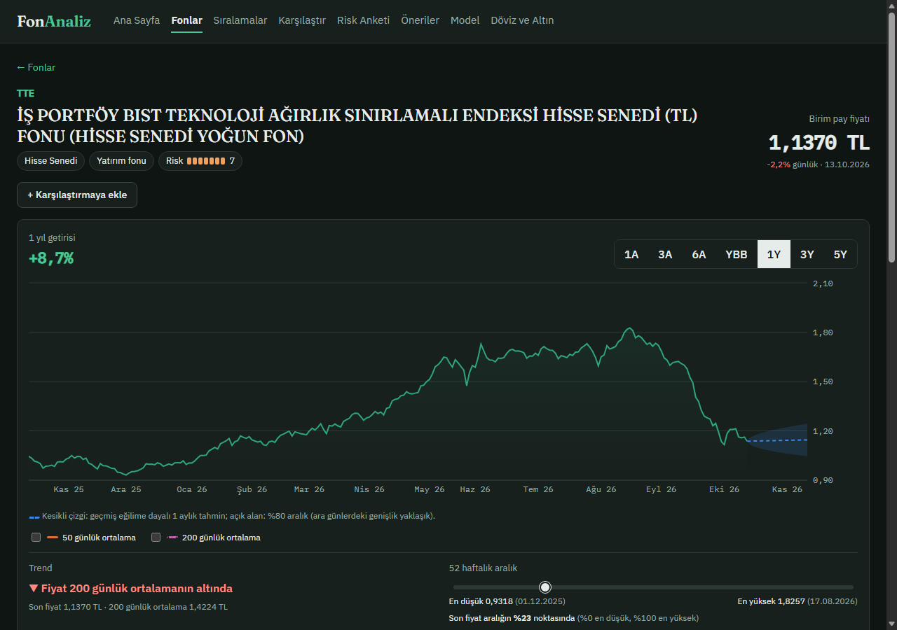
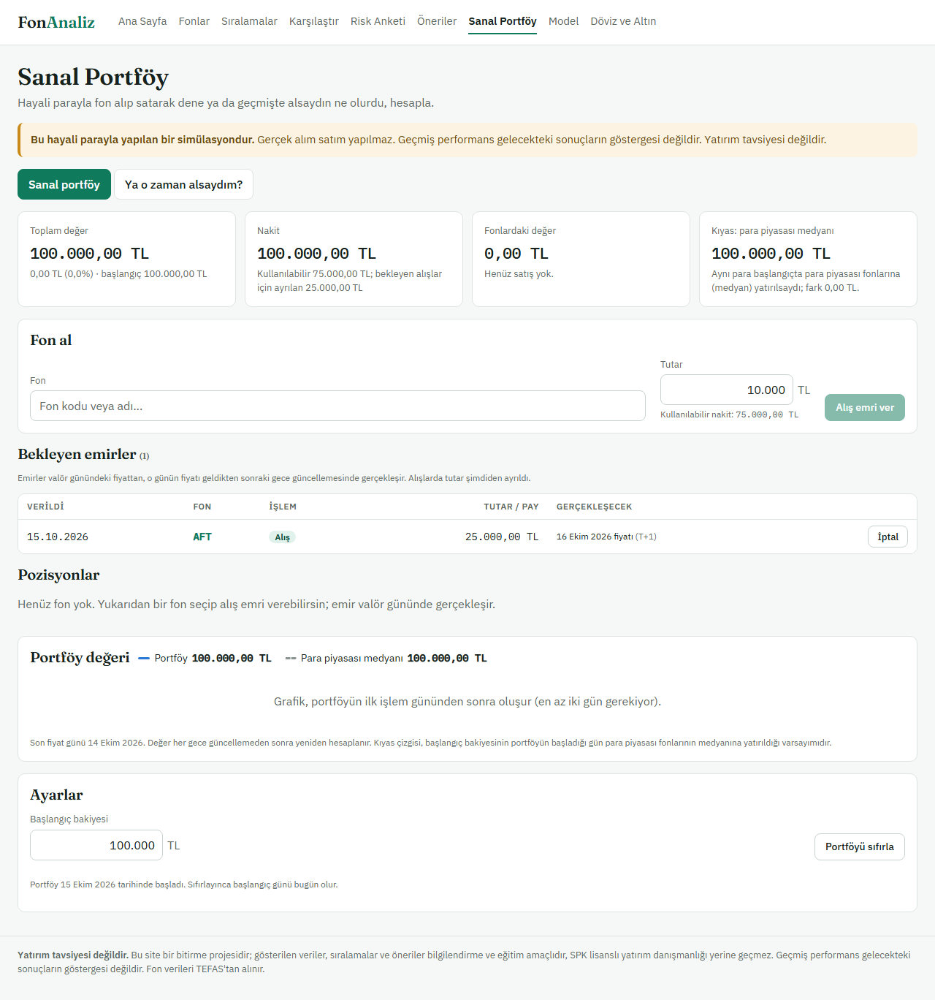
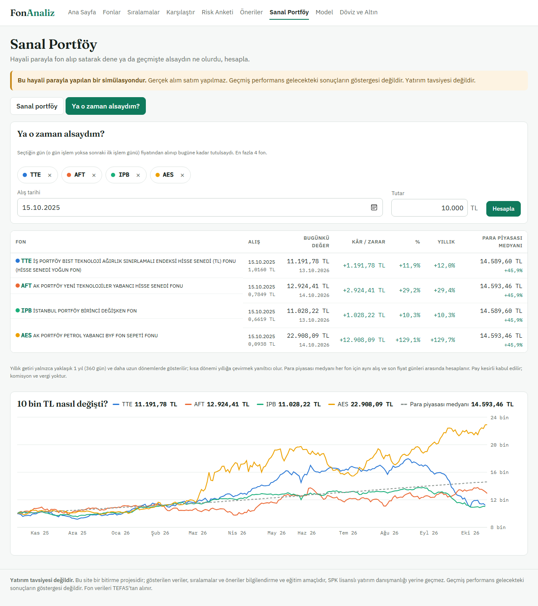

# 4. Ön Yüz (Frontend)

## 4.1 Amaç

Bu aşamada, backend'in sunduğu verileri kullanıcıya anlaşılır, karşılaştırılabilir ve gerekçeli biçimde gösteren, telefon ekranında da kullanılabilen bir web arayüzü geliştirdik.

## 4.2 Sayfalar

Ön yüz React 19 [4] ve Vite ile yazılmış tek sayfalık bir uygulamadır; grafikler Recharts [5] ile çizilir.

| Sayfa | İçerik |
|---|---|
| Ana sayfa | Büyük başlık ("Fonları karşılaştır, sana uygun olanı bul."), fon arama kutusu, risk anketine yönlendiren koyu kart (profil varsa önerilere), kategori kutuları, portföy büyüklüğüne göre öne çıkan 8 fon, veri durumu satırı (Şekil 4.5) |
| Fonlar | Arama, kategori ve risk süzgeci, metriğe, fon büyüklüğüne ya da yatırımcı sayısına göre sıralama, sayfalama; eski verili ve işleme kapatılan fonları gösterme seçeneği (Şekil 4.1) |
| Fon detayı | Fiyat grafiği ve dönem seçici (1 ay – 5 yıl, yılbaşından bu yana), 50 ve 200 günlük hareketli ortalama, trend etiketi ve 52 haftalık aralık (Bölüm 4.4), fon büyüklüğü ve yatırımcı sayısı (TEFAS'ın güncel değeri), getiri ve risk kartları, kategori sırası, SPK uyarısı, 1 aylık tahmin konisi, yatırım hesaplayıcı ve fonun KAP sayfasına bağlantı (Şekil 4.2; bağlantı TEFAS'tan gelir, KAP verisi saklanmaz, bkz. Bölüm 2.8) |
| Karşılaştır | En fazla 4 fon; 100'den başlayan grafik, logaritmik ölçek seçeneği, satırdaki en iyi değeri vurgulayan metrik tablosu (Şekil 4.3) |
| Sıralamalar | En yüksek getiri (dönem seçilebilir), en düşük volatilite, en yüksek Sharpe; kategori süzgeci |
| Risk anketi | Sorular tek tek, ilerleme çubuğu; sonuç kartı |
| Öneriler | Profil özeti, gerekçeli 10 öneri, örnek portföy, portföy planlayıcı, kayan pencereli test özeti (Bölüm 5) |
| Sanal Portföy | Hayali parayla alış/satış ve "Ya o zaman alsaydım?" (Bölüm 4.5, Şekil 4.7 ve 4.8) |
| Model | Tahmin modelinin bütün test sonuçları (Bölüm 6) |
| Döviz ve Altın | TCMB ve anlık kaynak sekmeleri |

## 4.3 Tasarım kararları

Arayüzü 15.10.2026'da tasarım taslaklarına yaklaştırdık. Her sayfanın önce/sonra ekran görüntüleri `docs/rapor/gorseller/tasarim/` klasöründedir (`once_*`, `sonra_*`; açık tema, koyu tema ve 390 px mobil). Görüntüler `frontend/scripts/ekran_goruntusu.mjs` betiğiyle, tarayıcının geliştirici protokolü üzerinden alınır; betik aynı anda yatay taşmayı da ölçer.

- **Tek yerde tanımlanan tema:** Bütün renkler ve yazı tipleri `index.css` dosyasının başında CSS değişkenleri olarak tanımlıdır. Sayfa stilleri renk kodu yerine yalnızca bu değişkenleri kullanır. Grafik renkleri de JavaScript'ten aynı değişkenlerle verilir (`src/theme.js`). SVG'nin `stroke` ve `fill` öznitelikleri `var(--…)` kabul ettiği için grafikler de temaya kendiliğinden uyar.

  | Değişken | Açık | Koyu | Kullanım |
  |---|---|---|---|
  | `--bg` | #f6f8f7 | #0f1513 | Sayfa zemini |
  | `--surface` | #ffffff | #18201d | Kart, tablo, panel |
  | `--ink` | #17211d | #e6ece9 | Ana yazı |
  | `--ink-2` | #5d6b65 | #9aaba3 | İkincil yazı |
  | `--line` | #dde4e1 | #2c3833 | Çizgiler, kenarlıklar |
  | `--brand` | #0f7a5c | #4cc497 | Ana renk: bağlantı, vurgu, artış |
  | `--brand-soft` | #e1f1eb | #14342a | Açık yeşil: seçili/en iyi hücre |
  | `--accent` | #b4570e | #f0a160 | Vurgu turuncu, yüksek risk |
  | `--danger` | #b3261e | #ff8a80 | Kırmızı: düşüş, hata |

- **Yazı tipleri:** Başlıklarda Fraunces, metinde IBM Plex Sans, sayılarda IBM Plex Mono kullanılır. Yazı tipleri `@fontsource` paketleriyle projeye dahildir ve build'e girer; uygulama internetsiz de aynı görünür. Yalnızca latin ve latin-ext alt kümeleri alınır (Türkçe harfler latin-ext'tedir); bu, build'deki font dosyalarını 37'den 16'ya, 564 kB'tan 320 kB'a indirdi. Tarayıcı bunlardan da yalnızca sayfadaki karakterlerin gerektirdiğini indirir.
- **Koyu tema:** İşletim sisteminin ayarına göre (`prefers-color-scheme`) açılır. Koyu temada renkler açık temanın tersine çevrilmedi; her değişken için koyu zeminde ayrıca seçildi. Ana yeşil, koyu zeminde okunabilmesi için açıldı (#4cc497); üzerinde beyaz yazı olan butonların zemini ise iki temada da koyu yeşil (#0f7a5c) kaldı (Şekil 4.6).
- **Kontrast:** Temada kullanılan 29 metin/zemin çiftinin kontrastını hesapladık; iki temada da hepsi WCAG AA sınırını (4,5:1) geçer. En düşükleri açık temadadır: açık yeşil zemin üzerindeki ana yeşil 4,54:1, beyaz üzerindeki turuncu 4,87:1, sayfa zemini üzerindeki ana yeşil 4,97:1. Koyu temadaki en düşük çift, koyu yeşil butonlardaki beyaz yazıdır (5,30:1).
- **Ortak bileşenler:** Kart, tablo, buton, dönem seçici, giriş kutusu ve etiketler bütün sayfalarda aynı stilleri kullanır. Tablo başlıkları küçük büyük harf, satırlar imleçle vurgulanır.
- **Risk çubuğu:** TEFAS risk değeri 7 bölmeli bir çubukla gösterilir; dolu bölme sayısı risk değerine eşittir, yanında sayı da yazar. Renk düşük (1–3) yeşil, orta (4–5) sarı, yüksek (6–7) turuncudur. Bilgi yalnızca renkle verilmez; ekran okuyucu için "/ 7 risk değeri" metni vardır.
- **Klavyeyle gezinme:** Her etkileşimli öğede görünür bir odak halkası (`:focus-visible`) vardır. İlk Tab'a basıldığında "İçeriğe geç" bağlantısı görünür ve menüyü atlayıp doğrudan içeriğe götürür. Tab sırasını ana sayfada betikle denedik: 1. Tab "İçeriğe geç", 2. logo, 3–10 menü bağlantıları, 11 arama kutusu, 12 "Ara" düğmesi; her adımda odak halkası görünür (`sonra_odak_ana.png`).
- **Türkçe biçimler:** Sayılar, yüzdeler ve tarihler Türkçe biçimde gösterilir (%12,5; 13.10.2026).
- **Renk paleti:**
  - Karşılaştırma ve model grafiklerinde dört renkli bir kategorik palet kullandık. Paleti renk körlüğü simülasyonunu da içeren bir doğrulama betiğiyle kontrol ettik: komşu renkler arasındaki en küçük fark ΔE 9,1 çıktı (hedef ≥ 8).
  - Sarı ve açık yeşilin beyaz zemin üzerindeki kontrastı düşük olduğu için bu grafiklerde lejant ve aynı verinin tablosu her zaman bulunur.
  - Bir fonun rengi, seçildiği yuvaya bağlıdır; listeden başka bir fon çıkarıldığında diğerlerinin rengi değişmez.
- **Uyarılar:** Her sayfanın altında "yatırım tavsiyesi değildir" uyarısı vardır. Öneri, hesaplayıcı ve planlayıcıda daha belirgin uyarı kutuları kullanılır.
  - Koyu temada kategorik palet aynı dört rengin koyu zemin için seçilmiş tonlarıdır (#3987e5, #d95926, #199e70, #c98500); doğrulama betiğinden koyu zemine (#18201d) göre ayrıca geçti.
- **Performans:** Grafik kütüphanesi büyük olduğu için grafikli sayfaları yalnızca açıldıklarında yükledik (lazy loading). İlk açılışta indirilen paket 700 kB'tan 297 kB'a indi; yeni ana sayfa ve tema ile 302 kB'tır.
- **Tarayıcıda saklama:** Risk profili ve karşılaştırma listesi tarayıcıda (`localStorage`) saklanır. Gizli pencerede erişilemezse sayfa yine çalışır, yalnızca hatırlamaz.

## 4.4 Teknik göstergeler

Fon detayındaki fiyat grafiğine üç basit teknik gösterge ekledik:

- **50 ve 200 günlük hareketli ortalama:** Son 50 ve 200 işlem gününün basit ortalaması. Grafikte iki ayrı çizgi olarak gösterilir ve kullanıcı her birini ayrı ayrı açıp kapatabilir; varsayılan olarak kapalıdır. Ortalamalar, grafikte seçilen dönemin başında da dolu olsun diye dönem başından 320 gün öncesinden itibaren hesaplanır. Pencere dolmadan (ör. 200 işlem gününden kısa geçmişi olan fonlarda) değer üretilmez.
- **Trend etiketi:** Son fiyat 200 günlük ortalamanın üstündeyse "Fiyat 200 günlük ortalamanın üstünde", altındaysa "altında" yazılır. Etiket yalnızca renkle değil, ok işareti (▲/▼) ve metinle de ayrışır.
- **52 haftalık aralık:** Son 52 haftanın en yüksek ve en düşük fiyatı, tarihleriyle birlikte. Son fiyatın bu aralıktaki yeri bir çubuk üzerinde ve yüzde olarak (%0 en düşük, %100 en yüksek) gösterilir. Fon 52 haftadan yeniyse başlık "… tarihinden beri aralık" olur.

Göstergeler backend'de hesaplanır (`app/services/technical.py`, `GET /api/funds/{kod}/technical`). Metriklerde olduğu gibi, tek gün sıçrayıp ertesi gün geri dönen hatalı fiyatlar hesaptan önce çıkarılır (Bölüm 3); fiyat verisi değiştirilmez. Trend ve 52 haftalık aralık grafikte seçilen dönemden bağımsızdır, her zaman son fiyat gününe göre hesaplanır.

14.10.2026 verisiyle fiyatı güncel ve işlemde olan 954 fonun 624'ünde fiyat 200 günlük ortalamanın üstünde, 260'ında altındadır; 70 fonun 200 günlük ortalama için yeterli geçmişi yoktur. En az 52 haftalık geçmişi olan 842 fonda son fiyatın aralıktaki yerinin medyanı %89'dur ve 412 fon aralığın üst %10'luk kısmındadır. Bu, fon fiyatlarının yüksek enflasyon ortamında çoğunlukla yükselme eğiliminde olmasıyla uyumludur; "zirveye yakın" olmak tek başına bir sinyal değildir.

Göstergelerin altında şu not yer alır: "Teknik göstergeler geçmiş fiyat hareketini özetler. Testlerimizde momentum ve 52 haftalık zirveye uzaklık gibi göstergeler gelecekteki getiriyi tahmin etmede basit ortalamadan daha iyi sonuç vermedi; hareketli ortalamalar ayrıca test edilmedi." Not, Bölüm 6'daki değerlendirmeye dayanır ve test edilenle edilmeyeni ayırır. Geçmiş getiri (momentum; 1, 3, 6 ve 12 aylık) ve 1 yıllık zirveye uzaklık, LightGBM modelinin özellikleri arasındaydı; ayrıca momentum tek başına bir referans yöntem olarak denendi. İkisi de fonun geçmiş ortalama getirisinin sürmesi varsayımını (drift) hiçbir risk grubunda geçemedi. 50 ve 200 günlük hareketli ortalamalar ise modelde ayrı bir özellik olarak denenmedi; bu yüzden onlar için bir başarı iddiasında bulunmuyoruz ve notta bunu açıkça belirtiyoruz. RSI ve MACD gibi daha karmaşık göstergeleri eklemedik: test etmediğimiz göstergeleri çoğaltmak kullanıcıya sinyal varmış izlenimi verebilir.

Grafik renkleri: 50 günlük ortalama turuncu (#c24a1a) düz çizgi, 200 günlük ortalama mor (#a83e8c) noktalı çizgidir. Fiyat (yeşil) ve tahmin (mavi) çizgileriyle birlikte dört renk, Bölüm 4.3'teki doğrulama betiğinden geçti (renk körlüğü simülasyonunda en küçük fark ΔE 6,5; bu nedenle 200 günlük ortalama ayrıca noktalı çizilir ve her çizginin lejantı vardır). Koyu temada aynı dört çizgi #2fa57a, #3987e5, #e0703a ve #c66bb0'dır; en küçük fark ΔE 7,2 olduğundan aynı ikincil kodlama (noktalı çizgi, lejant) burada da geçerlidir.

## 4.5 Sanal portföy

Sanal Portföy sayfası iki sekmeden oluşur; mantığı ve kuralları Bölüm 3.6'dadır. Sayfanın en üstünde, iki sekmede de görünen belirgin bir uyarı vardır: "Bu hayali parayla yapılan bir simülasyondur. Gerçek alım satım yapılmaz. Geçmiş performans gelecekteki sonuçların göstergesi değildir. Yatırım tavsiyesi değildir." Fon detay sayfasındaki "Sanal portföyde dene" düğmesi bu sayfayı fon seçili olarak açar.

**Sanal portföy sekmesi** (Şekil 4.7):

- *Özet kartları:* Toplam değer ve toplam kâr/zarar (TL ve %), nakit (kullanılabilir ve bekleyen alışlar için ayrılan), fonlardaki değer ve satışlardan gerçekleşen kâr/zarar, para piyasası medyanı kıyası ve fark.
- *Fon al:* Fon arama kutusu ve tutar. Fon seçilince son fiyat, alış valörü ("1 iş günü sonraki (T+1) fiyat") ve son işlem saati gösterilir. İşleme kapatılmış ya da eski verili fon seçilirse neden alınamadığı yazar ve düğme kapanır. Emir verilince hangi günün fiyatından gerçekleşeceği bildirilir.
- *Bekleyen emirler:* Ayrı bir tabloda, gerçekleşecekleri gün ve valörle; her biri iptal edilebilir.
- *Pozisyonlar:* Pay adedi, ortalama maliyet, maliyet, güncel fiyat ve değer, kâr/zarar (TL ve %). Her satırdaki "Sat" düğmesi satış formunu açar; "Tamamı" düğmesi satılabilir payların hepsini yazar, form satış valörünü ve bugünkü fiyatla yaklaşık tutarı gösterir.
- *Portföy değeri grafiği:* Günlük toplam değer ve kesikli çizgiyle para piyasası medyanı kıyası.
- *İşlem geçmişi* (açılır tablo) ve *ayarlar:* başlangıç bakiyesi ve iki adımlı "Portföyü sıfırla" onayı.

**"Ya o zaman alsaydım?" sekmesi** (Şekil 4.8): En fazla 4 fon, alış tarihi ve tutar seçilir. Sonuç tablosunda her fonun alış günü ve fiyatı, bugünkü değeri, kâr/zararı, yıllıklandırılmış getirisi ve aynı dönemde para piyasası medyanının vereceği değer yer alır. Grafikte fonlar ve kesikli çizgiyle para piyasası medyanı aynı tutardan başlar. Fon renkleri Karşılaştır sayfasındaki kategorik paletle ve aynı kuralla (renk, fonun seçim yuvasına bağlı) verilir. Fon seçilen tarihte henüz yoksa "Fon bu tarihte yoktu; ilk fiyat …" etiketi çıkar.

**Mobil.** Pozisyon, bekleyen emir ve "Ya o zaman alsaydım?" tabloları 600 px'in altında satır başına bir karta dönüşür. Her hücre kendi etiketiyle alt alta yazılır, böylece kâr/zarar ve "Sat" düğmesi yatay kaydırmadan görünür. 390 px'te iki sekmede de yatay taşma yoktur.

## 4.6 Mobil uyum

Arayüzü telefon genişliklerinde (360 ve 390 px) tarayıcının geliştirici protokolüyle açıp her sayfada yatay taşma olup olmadığını ölçtük; bütün sayfalarda sayfa genişliği ekran genişliğine eşittir. Geniş tablolar kendi kutuları içinde yatay kaydırılır. Tasarım değişikliğinden sonra ölçümü 390 px'te dokuz sayfanın hepsinde tekrarladık; taşma yoktur. Ana sayfada başlık ve anket kartı alt alta geçer, kategori kutuları iki sütuna iner; başlık çubuğu dar ekranda sayfayla birlikte kayar.

## 4.7 Karşılaşılan sorunlar ve çözümleri

| Sorun | Neden | Çözüm |
|---|---|---|
| Karşılaştırma sayfası 390 px'te 1.074 px genişliğe taşıyordu | Ekran okuyucu için gizlenen metinler (`.sr-only`, `position: absolute`) konumunu sayfaya göre alıp kaydırılabilir tablonun dışına çıkıyordu | Tablo kabına `position: relative` verildi; taşma ölçümle sıfırlandı |
| Telefon genişliğinde menü bağlantıları kelime kelime bölünüyordu | Bağlantıların satır kırma davranışı | Bağlantılar bölünmeden alt satıra geçecek şekilde düzenlendi |
| Grafik ekseninde aynı ay iki kez yazılıyordu ("Ara 25 Ara 25") | Kütüphanenin otomatik tik seçimi | Tikler her ayın ilk işlem gününden elle seçildi |
| Tahmin konisi grafikte görünmüyordu | Recharts 2, React Fragment içindeki serileri tanımıyor | Her seri ayrı koşulla eklendi |
| "%76'ini", "9'inde" gibi yanlış Türkçe ekler | Ekler sayıya göre değişiyor (%76'sını, 9'unda) | Metinler ek gerektirmeyen biçime çevrildi ("içerme oranı: %76", "9 / 24") |
| Büyük rakamlarda virgül etrafında boşluk | Eşit genişlikli yazı tipi | İlk sürümde büyük değerlerde normal yazı tipi kullanıldı; IBM Plex Mono'ya geçince büyük değerlerde harf aralığı biraz daraltıldı |
| Ekran görüntülerinde sayfanın alt kısmındaki grafikler boş çıkıyordu | Sayfanın tamamını çekerken tarayıcı pencereyi yeniden boyutlandırıyor, grafikler yeniden çizilirken görüntü alınıyordu | Betik önce pencereyi sayfa boyuna büyütüp grafiklerin çizilmesini bekliyor, sonra çekiyor |
| Headless tarayıcıda 390 px'lik görüntü yatay taşıyor gibi görünüyordu | Tarayıcı penceresinin en küçük genişliği 390 px'ten büyük | Genişlik pencere boyutuyla değil, geliştirici protokolünün ekran öykünmesiyle veriliyor; gerçek taşma yoktu |
| Koyu temada ana sayfadaki kartın düğmesi zemine karışıyordu | Açık yeşil zemin değişkeni koyu temada koyu yeşile dönüyor | Kart düğmesi için ayrı değişken (`--hero-btn`); koyu temada açık yeşil, kontrast 8,5:1 |
| Fon seçici sanal portföy formunda alanın altında büyük bir boşluk bırakıyordu | Karşılaştır sayfasındaki seçicinin esneme kuralı, sütun yönlü kapta dikeyde uzuyordu | Seçici ortak bileşene çıkarıldı (`FundPicker`); formda esneme kapatıldı |
| Telefonda "Ya o zaman alsaydım?" tablosunda sonuç sütunları ekran dışında kalıyordu | Geniş tablo yalnızca yatay kayıyordu | Tablolar dar ekranda etiketli kartlara dönüşüyor (`stack-table`) |
| Anket metinlerinde soru sayısı tutarsızdı ("7 soruluk") | Anket 9 soruya çıktıktan sonra metin güncellenmemişti | Metinler 9 soruya göre düzeltildi |

## 4.8 Kısıtlar

- Kullanıcı girişi ve favori fonlar uygulanmadı; profil ve karşılaştırma listesi tarayıcıya bağlıdır.
- Koyu tema yalnızca sistem ayarını izler; sayfada ayrı bir tema düğmesi yoktur.
- Ana sayfadaki "öne çıkan fonlar" portföy büyüklüğüne göre seçilir; bu bir sıralama ya da öneri değildir ve sayfada böyle belirtilir.
- Erişilebilirliği otomatik kontrast hesabı ve klavye denemesiyle sınadık; ekran okuyucuyla tam bir kullanıcı testi yapılmadı. [DOLDUR: kullanıcı testinde ekran okuyucu denenirse sonucu.]
