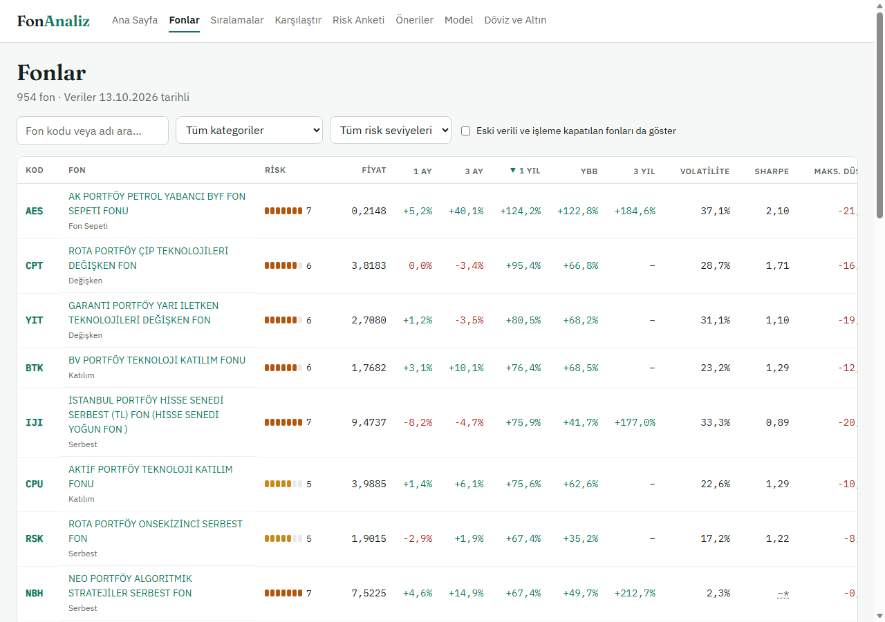
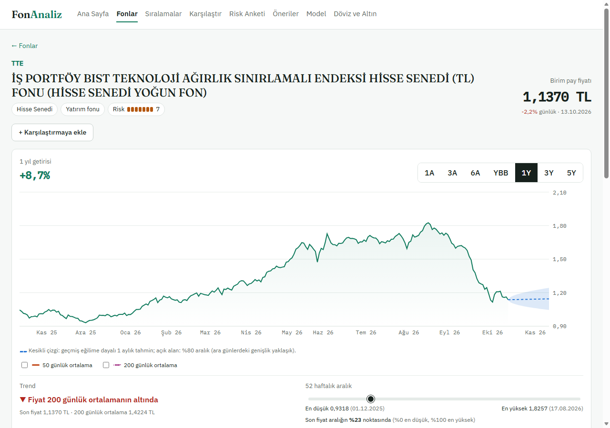
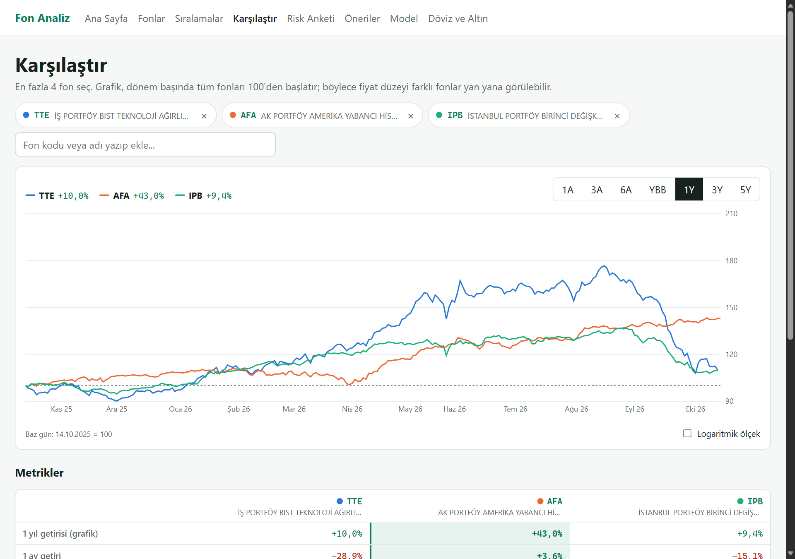
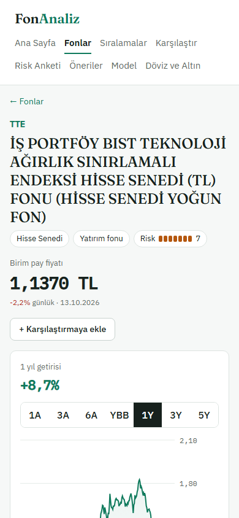

# 4. Ön Yüz (Frontend)

## 4.1 Amaç

Bu aşamada, backend'in sunduğu verileri kullanıcıya anlaşılır, karşılaştırılabilir ve gerekçeli biçimde gösteren, telefon ekranında da kullanılabilen bir web arayüzü geliştirdik.

## 4.2 Sayfalar

Ön yüz React 19 [4] ve Vite ile yazılmış tek sayfalık bir uygulamadır; grafikler Recharts [5] ile çizilir.

| Sayfa | İçerik |
|---|---|
| Fonlar | Arama, kategori ve risk süzgeci, metriğe göre sıralama, sayfalama; eski verili ve işleme kapatılan fonları gösterme seçeneği (Şekil 4.1) |
| Fon detayı | Fiyat grafiği ve dönem seçici (1 ay – 5 yıl, yılbaşından bu yana), getiri ve risk kartları, kategori sırası, SPK uyarısı, 1 aylık tahmin konisi, yatırım hesaplayıcı ve KAP'ın fon listesine bağlantı (Şekil 4.2; KAP verisi saklanmaz, bkz. Bölüm 2.8) |
| Karşılaştır | En fazla 4 fon; 100'den başlayan grafik, logaritmik ölçek seçeneği, satırdaki en iyi değeri vurgulayan metrik tablosu (Şekil 4.3) |
| Sıralamalar | En yüksek getiri (dönem seçilebilir), en düşük volatilite, en yüksek Sharpe; kategori süzgeci |
| Risk anketi | Sorular tek tek, ilerleme çubuğu; sonuç kartı |
| Öneriler | Profil özeti, gerekçeli 10 öneri, örnek portföy, portföy planlayıcı, kayan pencereli test özeti (Bölüm 5) |
| Model | Tahmin modelinin bütün test sonuçları (Bölüm 6) |
| Döviz ve Altın | TCMB ve anlık kaynak sekmeleri |

## 4.3 Tasarım kararları

- **Türkçe biçimler:** Sayılar, yüzdeler ve tarihler Türkçe biçimde gösterilir (%12,5; 13.10.2026).
- **Renk paleti:**
  - Karşılaştırma ve model grafiklerinde dört renkli bir kategorik palet kullandık. Paleti renk körlüğü simülasyonunu da içeren bir doğrulama betiğiyle kontrol ettik: komşu renkler arasındaki en küçük fark ΔE 9,1 çıktı (hedef ≥ 8).
  - Sarı ve açık yeşilin beyaz zemin üzerindeki kontrastı düşük olduğu için bu grafiklerde lejant ve aynı verinin tablosu her zaman bulunur.
  - Bir fonun rengi, seçildiği yuvaya bağlıdır; listeden başka bir fon çıkarıldığında diğerlerinin rengi değişmez.
- **Uyarılar:** Her sayfanın altında "yatırım tavsiyesi değildir" uyarısı vardır. Öneri, hesaplayıcı ve planlayıcıda daha belirgin uyarı kutuları kullanılır.
- **Performans:** Grafik kütüphanesi büyük olduğu için grafikli sayfaları yalnızca açıldıklarında yükledik (lazy loading). İlk açılışta indirilen paket 700 kB'tan 297 kB'a indi.
- **Tarayıcıda saklama:** Risk profili ve karşılaştırma listesi tarayıcıda (`localStorage`) saklanır. Gizli pencerede erişilemezse sayfa yine çalışır, yalnızca hatırlamaz.

## 4.4 Mobil uyum

Arayüzü telefon genişliklerinde (360 ve 390 px) tarayıcının geliştirici protokolüyle açıp her sayfada yatay taşma olup olmadığını ölçtük; bütün sayfalarda sayfa genişliği ekran genişliğine eşittir. Geniş tablolar kendi kutuları içinde yatay kaydırılır.

## 4.5 Karşılaşılan sorunlar ve çözümleri

| Sorun | Neden | Çözüm |
|---|---|---|
| Karşılaştırma sayfası 390 px'te 1.074 px genişliğe taşıyordu | Ekran okuyucu için gizlenen metinler (`.sr-only`, `position: absolute`) konumunu sayfaya göre alıp kaydırılabilir tablonun dışına çıkıyordu | Tablo kabına `position: relative` verildi; taşma ölçümle sıfırlandı |
| Telefon genişliğinde menü bağlantıları kelime kelime bölünüyordu | Bağlantıların satır kırma davranışı | Bağlantılar bölünmeden alt satıra geçecek şekilde düzenlendi |
| Grafik ekseninde aynı ay iki kez yazılıyordu ("Ara 25 Ara 25") | Kütüphanenin otomatik tik seçimi | Tikler her ayın ilk işlem gününden elle seçildi |
| Tahmin konisi grafikte görünmüyordu | Recharts 2, React Fragment içindeki serileri tanımıyor | Her seri ayrı koşulla eklendi |
| "%76'ini", "9'inde" gibi yanlış Türkçe ekler | Ekler sayıya göre değişiyor (%76'sını, 9'unda) | Metinler ek gerektirmeyen biçime çevrildi ("içerme oranı: %76", "9 / 24") |
| Büyük rakamlarda virgül etrafında boşluk | Eşit genişlikli yazı tipi | Büyük değerlerde normal yazı tipi + eşit genişlikli rakamlar |

## 4.6 Kısıtlar

- Kullanıcı girişi ve favori fonlar uygulanmadı; profil ve karşılaştırma listesi tarayıcıya bağlıdır.
- Koyu tema yoktur.
- Ana sayfa yalnızca veri durumunu gösteren basit bir sayfadır. [DOLDUR: sunum öncesi ana sayfa düzenlenirse güncellenecek.]
- "Taslaklardaki tasarımı uygula" maddesi henüz tamamlanmadı [DOLDUR].
