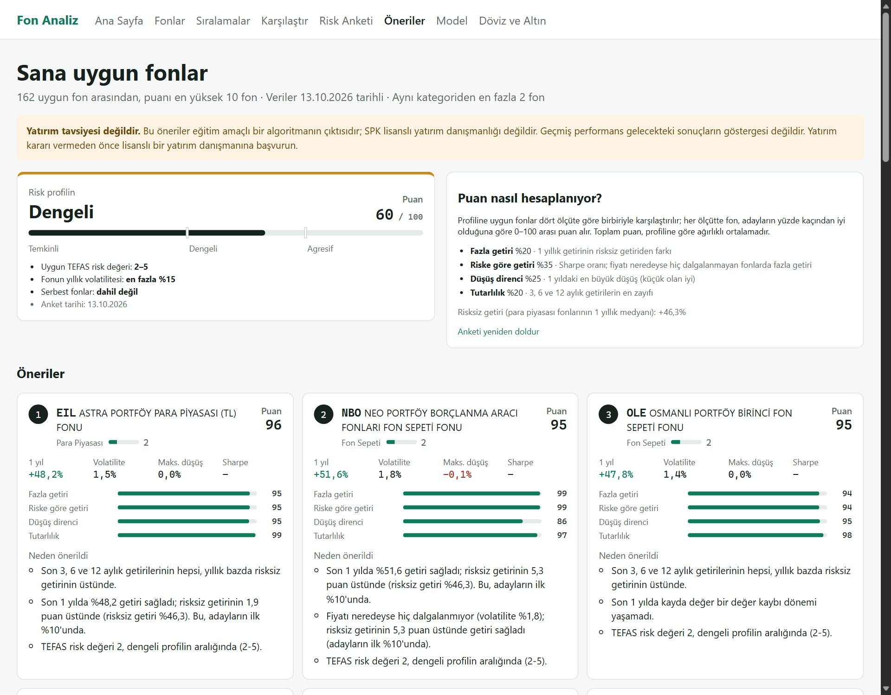
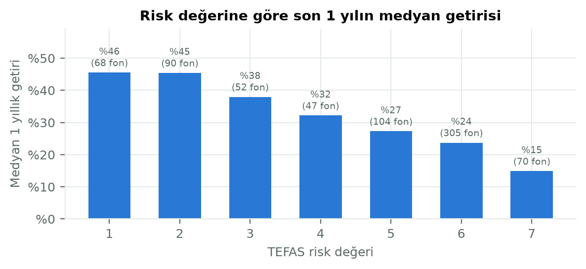
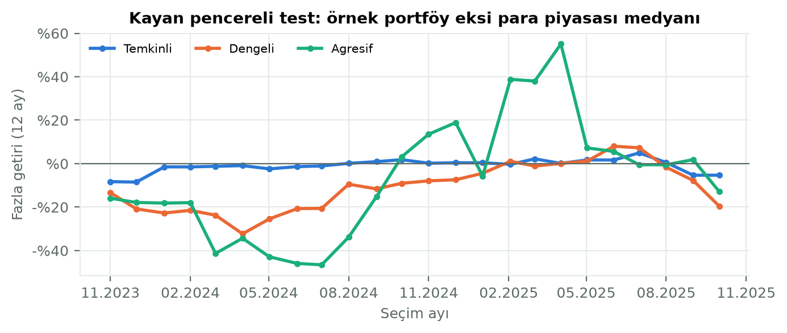

# 5. Risk Profili ve Öneri Sistemi

## 5.1 Amaç

Bu aşamada, kullanıcının risk taşıma kapasitesini ve isteğini kısa bir anketle ölçen, buna göre uygun fonları gerekçeleriyle öneren ve önerilerin geçmişte nasıl sonuç verdiğini dürüstçe gösteren bir sistem geliştirdik. Ayrıntılı yöntem belgesi `docs/oneri_sistemi.md`, analiz çıktıları `docs/oneri_analizi_cikti.md` dosyalarındadır. Bu bölümdeki sayılar 13.10.2026 verisine aittir.

## 5.2 Risk anketi

Anket 8 puanlı soru ve puana girmeyen 1 uygunluk sorusundan oluşur (`app/services/risk_survey.py`). Her cevap 0–4 puan alır ve sorunun ağırlığıyla çarpılır; ham puan (en fazla 60) 0–100'e ölçeklenir.

| Soru | Ağırlık | Gerekçe |
|---|---|---|
| Vade | ×3 | Risk taşıma kapasitesini en çok belirleyen etken |
| Kayıp toleransı | ×3 | Aynı nedenle |
| Davranış (3 ayda %15 düşüşte ne yaparsın?) | ×2 | Söylenen tolerans ile gerçek tepki arasındaki farkı yakalar |
| Hedef | ×2 | Risk isteğini ölçer |
| Birikim payı (yatırılacak tutar birikimin ne kadarı?) | ×2 | Kapasite: aynı kayıp birikimin küçük bir kısmında katlanılabilir, tamamında katlanılamaz |
| Gelir istikrarı, acil durum birikimi, deneyim | ×1 | Destekleyici etkenler |
| Nitelikli yatırımcı | puana girmez | Serbest fonlar yalnızca nitelikli yatırımcıya satılabilir [15]; "Evet" ise serbest fonlar da önerilir |

**Profil eşikleri ve risk aralıkları:**

| Puan | Profil | TEFAS risk değeri | Fonun 1 yıllık volatilitesi | Aday havuzu |
|---|---|---|---|---|
| 0–39 | Temkinli | 1–3 | en fazla %5 | 111 fon |
| 40–69 | Dengeli | 2–5 | en fazla %15 | 163 fon |
| 70–100 | Agresif | 4–7 | sınır yok | 382 fon |

Volatilite sınırı, TEFAS risk değerinin güncel olmadığı durumlara karşı ikinci bir kontroldür. %5 ve %15, SPK/ESMA risk göstergesi yönteminde 3. ve 5. risk sınıflarının üst sınırlarıdır [14].

**Sınırlayıcı kurallar.** Toplama dayalı bir puanda bir sorudaki düşük cevap, diğerlerinin yüksekliğiyle telafi edilebilir. Bu yüzden puandan bağımsız şu kuralları koyduk:

- Vade 1 yıldan kısaysa ya da kayıp toleransı "hiç" ise profil en fazla **temkinli** olur.
- Acil durum birikimi yoksa ya da yatırılacak tutar birikimin %75'inden fazlasıysa profil en fazla **dengeli** olur.

Uygulanan kural, sonuç ekranında gerekçesiyle gösterilir.

## 5.3 Aday fonlar ve puanlama

**Aday havuzu.** Bir fon şu koşulları sağlıyorsa adaydır:

- TEFAS'ta işlem görüyor,
- verisi güncel (son fiyatı en fazla 7 gün eski),
- SPK kararıyla kapatılmamış,
- 1 yıllık getirisi ve volatilitesi hesaplanabiliyor.

13.10.2026 itibarıyla bu koşulları sağlayan **841 fon** vardır. Üstüne profilin risk aralığı ve volatilite sınırı uygulanır; risk değeri boş olan fonlar öneri dışında kalır.

**Puanlama.** Dört bileşen, profilin aday havuzu içinde yüzdelik dilime çevrilir (en iyi 1, en kötü 1/n) ve profile özgü ağırlıklarla toplanır (`app/services/recommender.py`):

| Bileşen | Tanım | Temkinli | Dengeli | Agresif |
|---|---|---|---|---|
| Fazla getiri | 1 yıllık getiri − risksiz getiri | 0,15 | 0,20 | **0,35** |
| Riske göre getiri | Sharpe; volatilitesi %5 altı fonlarda fazla getiri | 0,25 | **0,35** | 0,30 |
| Düşüş direnci | 1 yıllık maksimum düşüş | **0,35** | 0,25 | 0,15 |
| Tutarlılık | 3, 6 ve 12 aylık yıllık getirilerin en zayıfı − risksiz getiri | 0,25 | 0,20 | 0,20 |

**Ağırlıkların gerekçesi:**

- **Temkinli:** Anaparayı korumak önceliklidir. Kayıplar asimetrik olduğu için (%20 kaybı telafi etmek %25 kazanç ister) en yüksek ağırlık düşüş direncindedir.
- **Dengeli:** Riske göre getiri öne çıkar.
- **Agresif:** Uzun vade, düşüşlerden toparlanmaya zaman tanıdığı için getiriye en yüksek ağırlığı verdik.
- **Optimize edilmedi:** Ağırlıklar uzman görüşüne dayanır. Az sayıda dönemle ağırlıkları "en iyi sonucu verecek" biçimde ayarlamak aşırı uyum riski taşırdı.

**Riske göre getiri ve düşük volatiliteli fonlar.** Volatilitesi %5'in altındaki fonlarda Sharpe hesaplanmadığı için (Bölüm 3.5) bu fonların "riske göre getiri" puanı fazla getiriyle ölçülür. Puanın hangi havuzda hesaplandığı profile göre değişir:

- **Temkinli:** Bu fonlar yalnızca kendi aralarında karşılaştırılır.
- **Dengeli ve agresif:** Bu fonlar bütün havuz içinde karşılaştırılır.

Bu değişikliğin dengeli profilin ilk 10'una etkisi küçük oldu: iki yöntem 10 fonun 9'unda aynı sonucu verdi.

**Çeşitlendirme ve gerekçeler.** Aynı kategoriden en fazla 2 fon önerilir. Her önerinin gerekçesi, fonun en güçlü iki bileşeninden ve profil uyumundan sayılarla otomatik üretilir; en zayıf bileşen alt %25'teyse bir "Dikkat" notu eklenir.

## 5.4 Ağırlık duyarlılığı

Ağırlıkları değiştirerek ilk 10'un ne kadar değiştiğini ölçtük. Denediğimiz değişiklikler:

- her bileşene +0,10 eklemek (diğerleri orantılı azalır),
- her bileşeni tek tek çıkarmak,
- dört bileşene eşit ağırlık vermek.

| Profil | İlk 10'da aynı kalan fon | En çok etkileyen değişiklik |
|---|---|---|
| Temkinli | 8–10 / 10 | Riske göre getirinin çıkarılması |
| Dengeli | 7–10 / 10 | Düşüş direncinin çıkarılması |
| Agresif | 5–10 / 10 | Düşüş direncinin çıkarılması |

±0,10'luk değişiklikler temkinli ve dengeli profillerde ilk 10'dan en fazla bir fonu değiştirdi. Agresif profil daha duyarlıdır: havuzu büyüktür (382 fon) ve fonların puanları birbirine yakındır.

## 5.5 Karşılaşılan sorun: dengeli profil ve riskli fon kotası

İlk sürümde dengeli profilin ilk 10'u tamamen para piyasası benzeri fonlardan oluşuyordu: volatilite %2'nin altında, maksimum düşüş sıfıra yakın. Bunun nedeni dönemin piyasa koşuluydu. Risksiz getiri %46 iken düşük riskli fonlar hem daha çok kazandırmış hem hiç düşmemişti (Şekil 5.1):

- risk değeri 1–2 olan fonların medyan 1 yıllık getirisi %45–46,
- risk değeri 7 olan fonlarınki %15.

Riske göre getiriyi ödüllendiren her yöntem, bu dönemde dengeli yatırımcıyı muhafazakâr fonlara yönlendirir. Bu yöntemin bir hatası değildi, ama "dengeli" etiketiyle de uyuşmuyordu.

**Kota.** Bu yüzden dengeli profilde önerilerin ve örnek portföyün en az ikisinin risk değeri 4 ve üstü, volatilitesi %5 ve üstü (yani gerçekten dalgalanan) fonlardan gelmesi kuralını ekledik.

- **Öneriler:** İlk 8 öneri değişmedi; 9. ve 10. sıraya FFH (risk 4, volatilite %5,7) ve IDY (risk 4, volatilite %9,0) girdi.
- **Örnek portföy:** EIL, NBO, FFH, IDY oldu.

## 5.6 Örnek portföy ve geriye dönük test

**Örnek portföy.** Öneriler arasından temkinli profilde 3, dengeli profilde 4, agresif profilde 5 fon seçilir. Ağırlıklar eşittir; portföy dönem başında alınıp yeniden dengelenmeden tutulur. Kıyas, para piyasası fonlarının medyanıdır. Kıyasa sonradan kapatılan fonlar da dahildir, yoksa kıyas olduğundan iyi görünürdü.

**Son 1 yıl iyimser.** Arayüzde gösterilen son 1 yıllık performans iyimserdir, çünkü fonlar aynı dönemin verisiyle seçilmiştir. Bugün seçilen portföyler bu dönemde kıyası geçmektedir (temkinli %48,8, dengeli %47,5, agresif %54,5; kıyas %46,3).

**Kayan pencereli test.** Gerçekçi bir değerlendirme için kayan pencereli test yaptık:

- Son üç yılda, ardından 12 aylık verisi olan her ayın ilk işlem gününde (01.11.2023 – 01.10.2025, 24 dönem) yalnızca o güne kadarki veriyle seçim yapıldı.
- Seçilen portföy 12 ay tutuldu.
- O gün fiyatı olan bütün fonlar adaydı, sonradan kapatılanlar da.

| Profil | Kıyası geçtiği dönem | Ort. fazla getiri | Medyan fazla getiri | En iyi dönem | En kötü dönem |
|---|---|---|---|---|---|
| Temkinli | 12 / 24 | −0,9 puan | −0,1 puan | 07.2025: +4,9 | 12.2023: −8,5 |
| Dengeli | 5 / 24 | −11,0 puan | −9,3 puan | 06.2025: +8,0 | 04.2024: −32,3 |
| Agresif | 9 / 24 | −7,0 puan | −9,3 puan | 04.2025: +55,1 | 07.2024: −46,6 |

Dönemlerin para piyasası medyanı ortalaması %55,3'tür. Nitelikli yatırımcı için (serbest fonlar dahil) temkinli profil 24 dönemin 18'inde kıyası geçmiştir.

**Değerlendirme:**

- **Temkinli:** Para piyasası medyanına çok yakın seyretti; zaten benzer fonlardan oluşuyordu.
- **Agresif:** Sonuç büyük ölçüde seçim zamanına bağlı. Kasım 2023 – Eylül 2024 arasında seçilen 11 portföyün hepsi geride kaldı; Ekim 2024 – Haziran 2025 arasındaki 9 seçimin 8'i kıyası geçti.
- **Dengeli kotanın etkisi:** Kota, geçmiş testte dengeli profilin sonucunu kötüleştirdi.

| Dengeli | Kıyası geçtiği dönem | Ort. fazla getiri | Medyan fazla getiri |
|---|---|---|---|
| Kotalı (kullanılan) | 5 / 24 | −11,0 puan | −9,3 puan |
| Kotasız | 8 / 24 | −8,1 puan | −4,2 puan |

Kotayı yine de tuttuk. Gerekçemiz geçmiş getiri değil, profil tutarlılığıdır: "dengeli" etiketli bir öneri listesinin tamamen para piyasası benzeri fonlardan oluşması kullanıcının beklentisiyle çelişir. Kotanın değeri, risk almanın ödüllendirildiği dönemlerde ortaya çıkar; elimizdeki veri tek bir yüksek faiz dönemini kapsadığı için bunu sınayamadık.

**Örtüşen dönemler.** Dönemler birer ay arayla başlayıp 12 ay sürdüğü için büyük ölçüde örtüşür; 24 dönem, bağımsız 24 deneme değildir.

## 5.7 Örnek kişiler

| Kişi | Puan | Profil | Not |
|---|---|---|---|
| Ayşe, 26, uzun vadeli birikim | 77 | Agresif | – |
| Mehmet, 58, emekliliğe 2 yıl | 37 | Temkinli | – |
| Zeynep, 40, orta yol | 58 | Dengeli | Örnek portföy EIL, NBO, FFH, IDY |
| Can, 30, birikimi yok ama riskli | 78 | Dengeli | Puana göre agresif; acil durum birikimi olmadığı için dengeliye indi |

## 5.8 Kısıtlar

- Geriye dönük testte fonların geçmişteki risk değeri ve kategorisi bilinmediği için güncel değerler kullanıldı.
- Alım-satım masrafı ve stopaj hesaba katılmadı; portföy yeniden dengelenmiyor.
- Test dönemi tek bir yüksek faiz ortamını kapsar.
- Profil kullanıcı girişi olmadığı için tarayıcıda saklanır.
- Sistem yatırım danışmanlığı değildir; öneriler eğitim amaçlıdır ve her yerde bu uyarı bulunur.
