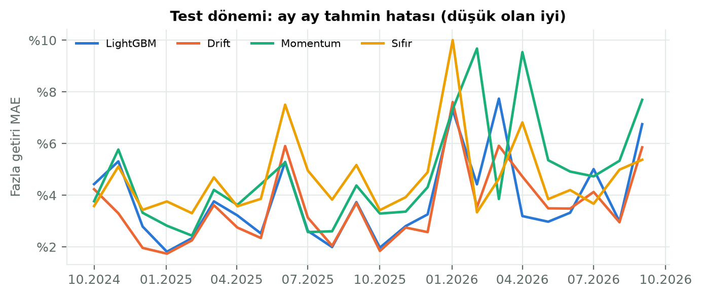
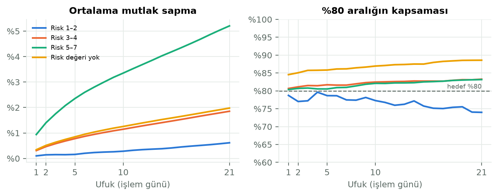
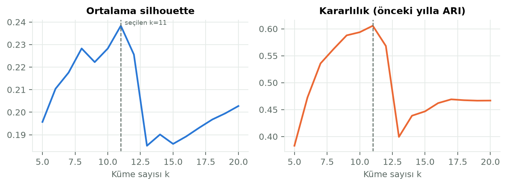
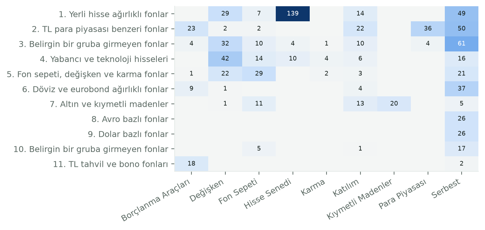
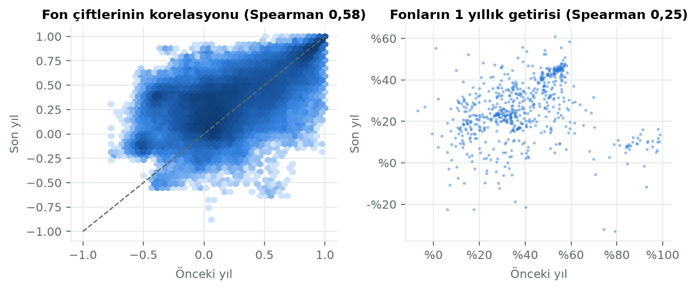

# 6. Makine Öğrenmesi ile Getiri Tahmini

## 6.1 Amaç

Bu bölümde, TEFAS yatırım fonlarının gelecek bir aylık getirisinin makine öğrenmesi yöntemleriyle tahmin edilip edilemeyeceği incelenmiştir. Çalışmanın amacı yalnızca bir model kurmak değil, kurulan modelin **basit referans yöntemlerden daha iyi olup olmadığını** gelecekten bilgi sızdırmayan bir test düzeneğiyle ölçmek ve sonuca göre platformda neyin gösterileceğine karar vermektir.

## 6.2 Hedef değişkenin seçimi

Tahmin hedefi olarak fon fiyatının kendisi değil, **21 işlem günlük (yaklaşık bir aylık) getiri** seçilmiştir. Bunun üç gerekçesi vardır:

1. **Durağanlık ve karşılaştırılabilirlik.** Fon fiyatları durağan değildir ve ölçekleri çok farklıdır (veri setinde 0,01 TL'nin altından 10.000 TL'nin üstüne kadar). Fiyat düzeyinde kurulan bir modelde "yarın da bugünkü fiyat" tahmini bile yüksek isabet gösterir; bu, modelin bilgi taşıdığı anlamına gelmez. Getiri birimsizdir ve bütün fonlar tek bir modelde ortak bir ölçekte değerlendirilebilir.
2. **Karar ile ilişki.** Yatırımcının sorusu "fon ne kadar kazandırır?" sorusudur; getiri tahmini platformdaki diğer bütün metriklerle aynı birimdedir.
3. **Ufuk.** Daha kısa ufuklarda gürültü sinyali bastırır; daha uzun ufuklarda ise yaklaşık dört yıllık veride bağımsız gözlem sayısı azalır.

Modeller getirinin kendisini değil, **para piyasası (PP) fonlarının medyan getirisine göre fazla getiriyi** öğrenecek şekilde kurulmuştur. Faiz düzeyi bütün fonları birlikte etkiler ve fon özelliklerinden öngörülemez; bu bileşen ayrıca, PP fonlarının son bir yıllık ortalama getirisiyle (drift) tahmin edilmiş ve ham tahmin bu iki parçanın toplamı olarak elde edilmiştir.

## 6.3 Veri

Her ayın ilk işlem günü, o gün fiyatı güncel olan ve en az bir yıllık geçmişi bulunan her fon için bir gözlem oluşturulmuştur: 01.11.2022 – 01.09.2026 arasında 47 başlangıç günü, **910 fon, 28.286 gözlem**. Hedef değişkenin dağılımı iki önemli özellik göstermektedir:

- Gözlemlerin **%79,3'ünde** bir aylık getiri pozitiftir; yalnızca %38,4'ünde getiri PP medyanının üzerindedir. Bu nedenle getirinin işaretini doğru tahmin etme oranı yanıltıcı bir ölçüttür: her zaman "artar" diyen bir tahminci bile yaklaşık %79 isabet alır.
- Oynaklık risk değerine göre çok farklıdır: aylık getirinin standart sapması risk değeri 1–2 olan fonlarda %1,1, 3–4 olanlarda %3,3, 5–7 olanlarda %8,9'dur. Bu nedenle bütün metrikler risk grubu bazında ayrıca raporlanmıştır.

Özellikler yalnızca tahmin günü ve öncesindeki fiyatlardan hesaplanmıştır: 1, 3, 6 ve 12 aylık getiriler; 3 ve 12 aylık volatilite; 12 aylık maksimum düşüş; 12 aylık zirveye uzaklık; getirinin o gün bütün fonlar arasındaki yüzdelik sırası (1 ve 12 aylık); kategori; TEFAS risk değeri; PP fonlarının 1 ve 12 aylık medyan getirisi.

## 6.4 Yöntemler

**Referans yöntemler.** (i) Sıfır getiri; (ii) *drift*: fonun son bir yıllık getirisinin aylık karşılığının sürmesi; (iii) *momentum*: son bir ayın getirisinin aynen tekrarlanması. Bir modelin başarılı sayılması için yalnızca sıfır getiriyi değil, **en iyi referansı** geçmesi gerekir.

**ARIMA** [30]**.** Fon bazında, günlük log getiriler (son iki yıl) üzerinde ARIMA(p,0,q), p,q ∈ {0,1,2}, sabit terimli; 21 adımlık tahminlerin toplamı aylık getiriye çevrilmiştir. Mertebe, her fon için ilk test ayından önce AIC ile bir kez seçilmiş, sonra her ay yeniden kestirilmiştir (statsmodels [31]). Hesaplama maliyeti nedeniyle her risk grubundan 10 fon olmak üzere 40 fonluk tabakalı bir örnek kullanılmıştır. Prophet, tatil ve haftalık/yıllık mevsimsellik gibi iş verilerine özgü yapılar için tasarlandığından ve fon fiyatlarında bu tür bir yapı bulunmadığından tercih edilmemiştir.

**LightGBM** [32]**.** Bütün fonlarda ortak eğitilen gradient boosting modeli; hedef fazla getiri, kayıp fonksiyonu mutlak hata (L1). Eğitimde hedefin uç değerleri %0,5–99,5 dilimlerine kırpılmıştır. Hiperparametreler, aşağıda tanımlanan ayar döneminde 12 aday arasından seçilmiştir (`num_leaves`=15, `min_child_samples`=100, 150 ağaç, öğrenme oranı 0,03).

## 6.5 Değerlendirme düzeneği

**Walk-forward test.** Her test ayının ilk işlem günü model, hedef penceresi o günden *önce* biten bütün gözlemlerle yeniden eğitilmiş (genişleyen pencere) ve o günkü fonlar için tahmin üretmiştir. Böylece hiçbir tahmin, kendi gerçekleşmesinden ya da tahmin gününden sonraki bir fiyattan bilgi almaz. Sızıntıya karşı ayrıca şu önlemler alınmıştır: tek günlük hatalı fiyat temizliği ertesi güne baktığı için tahmin gününün kendi fiyatında temizlenmemiş değer kullanılmış; güven aralıkları yalnızca gerçekleşmiş geçmiş hatalarla kurulmuş; tahmin gününde fiyatı olan bütün fonlar (sonradan SPK kararıyla kapatılanlar dahil) teste alınmıştır. Bu kuralların her biri birim testleriyle doğrulanmıştır.

**Takvim.** Ayar dönemi: 10.2023 – 09.2024 (12 ay); hiperparametre seçimi yalnızca burada yapılmıştır. Test dönemi: 10.2024 – 09.2026 (24 ay, 17.261 tahmin); ayar sırasında kullanılmamıştır.

**Metrikler.** Ortalama mutlak hata (MAE) ve karekök ortalama kare hata (RMSE), hem ham getiri hem fazla getiri üzerinden; yön doğruluğu iki biçimde (getirinin işareti ve fonun PP medyanının üstünde mi altında mı kalacağı); ay içi sıralama korelasyonu (Spearman); her ay tahmini en yüksek 10 fonun gerçekleşen ortalama getirisi ("ilk 10"); %80 güven aralığının kapsama oranı.

**Başarı ölçütü** (sonuçlar görülmeden önce tanımlanmıştır): Model, bir risk grubunda o grubun en iyi referansına göre **hem** daha düşük fazla getiri MAE'si **hem** daha yüksek "ilk 10" getirisi sağlarsa o grupta başarılı sayılır.

## 6.6 Bulgular

**Tablo 6.1** Test dönemi genel sonuçlar (24 ay, 17.261 tahmin)

| Model | Fazla getiri MAE | Fazla getiri RMSE | PP üstü/altı yönü | Sıralama korelasyonu | İlk 10 (aylık ort.) | %80 aralık kapsamı |
|---|---|---|---|---|---|---|
| Drift | **%3,65** | **%7,31** | %64,5 | **0,155** | %4,10 | %77,0 |
| LightGBM | %3,88 | %7,46 | %59,6 | 0,054 | **%7,57** | %75,1 |
| Sıfır getiri | %4,70 | %7,67 | %66,5 | – | – | %76,6 |
| Momentum | %4,91 | %9,44 | %59,6 | 0,140 | %7,37 | %75,8 |

Aynı aylarda bütün fonların ortalama aylık getirisi %2,61, PP medyanı %3,54'tür.

**Tablo 6.2** Başarı ölçütü (her grupta en iyi referans drift'tir)

| Risk grubu | Tahmin | LightGBM / drift fazla MAE | LightGBM / drift ilk 10 | LightGBM'in daha iyi olduğu ay | Sonuç |
|---|---|---|---|---|---|
| 1–2 | 2.911 | %0,40 / %0,32 | %3,44 / %3,64 | 4 / 24 | Başarısız |
| 3–4 | 2.163 | %2,21 / %1,97 | %2,81 / %3,15 | 7 / 24 | Başarısız |
| 5–7 | 9.997 | %5,59 / %5,32 | %7,58 / %4,51 | 9 / 24 | Başarısız |
| Risk değeri yok | 2.190 | %2,34 / %2,14 | %1,98 / %2,66 | 8 / 24 | Başarısız |

**ARIMA.** 40 fonluk örnekte ARIMA'nın fazla getiri MAE'si %2,32, aynı fonlarda drift'inki %2,33, LightGBM'inki %2,56'dır; sıralama korelasyonu ARIMA'da 0,210, drift'te 0,185'tir. Seçilen mertebelerin çoğu çok düşük derecelidir (6 fonda (0,0,0), 9 fonda (0,0,1), 7 fonda (1,0,0)). ARIMA'nın drift'ten pratikte ayırt edilememesi, fon getirilerinde kısa vadeli, doğrusal ve öngörülebilir bir yapının neredeyse bulunmadığını göstermektedir.

**Değerlendirme.**

1. **En iyi tahminci en basit yöntemdir.** Drift, genel sonuçta ve dört risk grubunun hepsinde en düşük hatayı ve en yüksek sıralama korelasyonunu vermiştir. LightGBM önceden tanımlanan ölçütü hiçbir grupta karşılayamamıştır.
2. **LightGBM fonları birbirinden ayırt etmeyi öğrenememiştir.** Ay içi sıralama korelasyonu 0,054'tür. Son test ayında eğitilen modelde en önemli iki özellik PP fonlarının 12 ve 1 aylık getirileridir (kazanç payı %25,0 ve %16,2); bu özellikler aynı ay içinde bütün fonlar için aynı değeri alır. Model, fonlar arasındaki farktan çok "bu ay fonlar genel olarak PP'yi ne kadar geçer" sorusunu öğrenmeye çalışmış; bu da sıralama performansını düşürmüştür.
3. **Riskli fonlarda "ilk 10" sonucu güvenilir bir sinyal değildir.** Risk 5–7 grubunda LightGBM'in seçtiği ilk 10 fon aylık ortalama %7,58 kazandırmış, ancak aynı sonuca momentum da yaklaşmıştır (%7,74) ve aylık sonuçlar çok dağınıktır. Eylül 2026'da drift'in seçtiği ilk 10 fonun 7'si, 17.09.2026'da SPK kararıyla işleme kapatılan şirketlere aittir ve bu fonların bir kısmı aynı ay içinde %92–98 değer kaybetmiştir (seçim gününde bu bilinemezdi). 24 aylık, tek bir faiz dönemini kapsayan bir testte bu büyüklükteki farklar istatistiksel olarak anlamlı kabul edilemez.
4. **Güven aralıkları makul ölçüde kalibredir.** %80 hedefe karşı test dönemindeki kapsama %75–77 düzeyindedir.

## 6.7 Keşif amaçlı ek analiz (test sonuçları görüldükten sonra)

> Bu bölümdeki varyant, test sonuçları görüldükten **sonra** tanımlanmıştır. Bu nedenle sonuçları iyimser kabul edilmeli ve ana bulgu olarak yorumlanmamalıdır. Sonuç ne olursa olsun platformdaki karar değiştirilmemiştir.

Bölüm 6.6'daki ikinci bulgudan hareketle tek bir varyant önceden tanımlanmış ve denenmiştir: hedef, fonun **aynı ay içindeki fazla getiri yüzdelik sırası** olarak değiştirilmiş; ay içinde bütün fonlar için aynı olan iki özellik (PP'nin 1 ve 12 aylık getirisi) çıkarılmıştır. Hiperparametreler yeniden ayarlanmamış, asıl modelinkiler kullanılmıştır. Sıra tahmini, hata hesaplanabilsin diye son eğitim ayının fazla getiri dağılımının ilgili dilimine çevrilmiştir; bu varyant için asıl ölçüt sıralama korelasyonu ve "ilk 10"dur.

| Model | Fazla getiri MAE | PP üstü/altı yönü | Sıralama korelasyonu | İlk 10 (aylık ort.) |
|---|---|---|---|---|
| Drift | %3,65 | %64,5 | 0,155 | %4,10 |
| LightGBM (asıl) | %3,88 | %59,6 | 0,054 | %7,57 |
| LightGBM, ay içi sıra hedefi (keşif) | %4,06 | %60,2 | 0,109 | %6,97 |

Sıra hedefi, sıralama korelasyonunu 0,054'ten 0,109'a çıkarmıştır; yani modelin fonları birbirinden ayırt etme yeteneği iyileşmiştir. Ancak drift'in 0,155'lik korelasyonuna ulaşılamamış, hata ve "ilk 10" açısından da asıl modele göre bir kazanım elde edilmemiştir. Bu varyantta en önemli özellikler fonun kendi geçmiş getirileridir (1 aylık %14,4, 6 aylık %13,0, 12 aylık sıra %12,4); bu da modelin, drift'in zaten kullandığı bilgiyi daha gürültülü biçimde öğrendiğini düşündürmektedir.

## 6.8 LSTM'in kapsam dışı bırakılma gerekçesi

Planlama aşamasında LSTM (uzun kısa süreli bellek) ağları opsiyonel olarak ele alınmış ve aşağıdaki gerekçelerle bu çalışmanın kapsamı dışında bırakılmıştır:

1. **Veri yapısı.** Veri seti, en fazla yaklaşık 1.250 günlük (TEFAS'ın verdiği 5 yıl) yaklaşık bin zaman serisinden oluşmaktadır. Aylık örneklemeyle bağımsız gözlem sayısı fon başına 47'yi geçmez. Derin öğrenme modellerinin genelleme yapabilmesi için gereken veri miktarı bunun çok üzerindedir; orta büyüklükteki tablo biçimli verilerde ağaç tabanlı yöntemlerin derin öğrenme modellerine genellikle eşit ya da üstün sonuç verdiği gösterilmiştir [33].
2. **Sinyalin zayıflığı.** ARIMA'nın drift'ten ayırt edilememesi ve LightGBM'in referansı geçememesi, fon getirilerinde öğrenilebilir kısa vadeli yapının çok zayıf olduğunu göstermiştir. Aynı geçmiş getiri dizilerini girdi olarak kullanacak bir LSTM'in, bu yapıyı ortaya çıkarması için ek bir gerekçe yoktur; daha esnek bir model, zayıf sinyal altında gürültüye uyum sağlama (aşırı öğrenme) riskini artırır.
3. **Önceden belirlenen karar kuralı.** Plan aşamasında, LSTM'e ancak LightGBM anlamlı bir sinyal gösterirse dönülmesi kararlaştırılmıştı. LightGBM önceden tanımlanan başarı ölçütünü hiçbir risk grubunda karşılayamadığı için bu koşul gerçekleşmemiştir.
4. **Maliyet ve yayın kısıtı.** LSTM için gereken PyTorch kütüphanesi yaklaşık 200 MB'tan büyüktür ve CPU üzerinde eğitim ile hiperparametre ayarı, ARIMA ve LightGBM'in birkaç dakikalık sürelerinin çok üzerindedir. Plan aşamasında öngörülen ücretsiz sunucunun 512 MB belleği de modelin çalıştırılmasını zorlaştıracaktı (uygulama daha sonra yayına alınmama kararıyla yerelde çalıştırılmaktadır).
5. **Zaman.** Kalan iş paketleri (kullanıcı testi, rapor ve sunum) göz önüne alındığında, olumlu sonuç verme olasılığı düşük bir modele ayrılacak yaklaşık iki çalışma oturumunun bu paketlere ayrılması tercih edilmiştir.

LSTM, daha uzun bir veri dönemi (birden fazla faiz rejimi) ya da fon portföy içeriği gibi ek bilgi kaynakları elde edildiğinde yeniden değerlendirilebilecek bir gelecek çalışma olarak bırakılmıştır.

## 6.9 Platformdaki uygulama

Önceden belirlenen karar kuralı gereği, başarı ölçütünü karşılayamayan LightGBM'in tahminleri platformda gösterilmemiştir. Bunun yerine fon detay sayfasında, testlerde en isabetli çıkan yöntem olan drift'e dayalı **"geçmiş eğilime dayalı tahmin"** gösterilmektedir:

- Tahmin: fonun son bir yıllık getirisinin aylık karşılığı.
- %80 aralık: drift'in aynı risk grubundaki geçmiş hatalarının %10 ve %90 dilimleri (konformal yöntem [34], [35]). Aralığın test dönemindeki kapsama oranı kullanıcıya gösterilmektedir. İlk sürümde aralık yalnızca 21 günlük ufuk için ve ayın ilk işlem günü başlatılan tahminlerle kurulmuştu (kapsama: risk 1–2 grubunda %73,4, 3–4'te %75,0, 5–7'de %75,7, risk değeri bulunmayan fonlarda %82,6). 13.11.2026'dan itibaren her ufuk için ayrı kurulmaktadır (Bölüm 6.10); 21 günlük ufukta kapsama %74,0 / %83,3 / %83,2 / %88,6'dır.
- Etiket: "Bu bir ML tahmini değildir; testlerde en isabetli yöntem fonun geçmiş ortalama getirisinin sürmesi varsayımı çıktı."
- Fiyat grafiğinde bir aylık tahmin konisi (her işlem günü için ayrı tahmin ve aralık; resmî tatiller atlanır) ve tutara göre beklenen değer ile aralığı TL olarak gösteren bir hesaplayıcı; öneri sayfasında örnek portföy için aynı hesabı yapan bir planlayıcı. Her ikisinde "eğitim amaçlı örnek dağılımdır, yatırım tavsiyesi değildir" uyarısı yer almaktadır.
- "Model performansı" sayfasında, başarısız olanlar dahil bütün sonuçlar ve keşif analizi ayrı olarak yayımlanmaktadır.

Tahminler her gece, değerlendirme raporu ise ayda bir otomatik olarak yenilenmektedir (gece işi yaklaşık 10 saniye; aylık rapor yaklaşık 20 saniye ek süre).

## 6.10 Gün gün tahmin ve tahmin karnesi

Bir tahminin ne kadar güvenilir olduğunu kullanıcıya göstermenin en doğrudan yolu, geçmişte yapılan tahminleri gerçekleşenle yan yana koymaktır. Bu amaçla platforma bir **tahmin karnesi** ekledik. İlk sürümde her gece yalnızca 21 günlük tahmin üretiliyor ve bir önceki gecenin tahminleri siliniyordu; bu yüzden karne için geçmiş birikmemişti (13.11.2026'da veritabanında yalnızca 22.10.2026 tarihli 844 kayıt vardı).

**Gün gün tahmin.** Her gece, her fon için 1'den 21'e kadar her işlem günü ufkunda ayrı bir tahmin üretip kalıcı olarak saklıyoruz: tahmin günü, o günkü fiyat, ufuk, hedef tarih, tahmin edilen fiyat, %80 aralığın alt ve üst sınırı, yöntem ve yöntem sürümü. Tahmin, drift'in ufka genellenmiş hâlidir: h günlük ufukta (1 + son 1 yıllık getiri)^(h/252) − 1. Kayıtlar hiçbir zaman güncellenmez ya da silinmez; gerçekleşen fiyat tabloya yazılmaz, karşılaştırma anında fiyat tablosundan okunur. Her kayıtta yöntemin adı ve sürümü (`drift-konformal v1`) bulunur; yöntem ileride değişirse eski kayıtlar yapıldıkları sürümle kalır ve yeniden hesaplanmaz. Silinmeden önce kurtarılan 22.10.2026 kayıtları farklı bir yöntemle yapıldığı için `v0` olarak işaretlenmiştir.

**Hedef tarih.** Ufuk işlem günüyle tanımlıdır. Hedef tarihi hafta sonları ve Türkiye'nin resmî tatilleri (dinî bayramlar dahil; `holidays` kütüphanesi) atlanarak hesaplıyoruz. Bu takvimi 14.10.2021–22.10.2026 arasındaki 1.264 fiyat günüyle karşılaştırdık; fark çıkmadı. Arife günleri yarım gün olsa da TEFAS fiyat yayınladığı için işlem günü sayılır. Gerçekleşen değer, fiyat verisindeki h'inci işlem gününden ölçülür; böylece takvimde olmayan bir kapanış olursa hedef tarih veriden düzelir.

**Ufka göre konformal aralık.** Önceki aralık yalnızca 21 günlük ufka göre kalibre edilmişti; 1 günlük bir tahmin için bu aralık çok geniş kalırdı. Artık her ufuk h ve risk grubu için aralığı ayrı kuruyoruz: t günündeki tahminin aralığı, drift'in geçmişte her işlem gününden başlatılan h günlük tahminlerinin hatalarından, **yalnızca hedef günü t'den önce gelmiş olanlar** kullanılarak hesaplanan %10 ve %90 dilimleridir. Bir grupta 50'den az hata varsa bütün grupların hataları kullanılır. Ayrıca t günündeki uygunluk denetimi (fiyatı güncel mi, son bir yılda yeterli fiyatı var mı) için t gününün temizlenmemiş fiyatına bakıyoruz; tek günlük hata temizliği t+1'e baktığı için bu, Bölüm 6.5'teki özellik hesabında kalan küçük bir sızıntıyı da kapatır. Sızıntı olmadığını, t'den sonraki bütün fiyatlar bozulduğunda t günündeki tahminin ve aralığın değişmediğini göstererek test ettik.

**Değerlendirme.** Aynı test döneminde (01.10.2024–30.09.2026, 502 işlem günü) her işlem günü başlatılan tahminleri değerlendirdik. Hız için bu değerlendirmede aralığı ayda bir, ayın ilk işlem günü yeniden kurduk (kalibrasyon günü her zaman tahmin gününden önce ya da aynı gündür); sitedeki canlı tahminde aralık her gece kurulur.

**Tablo 6.3** Ufka göre %80 aralığın kapsaması ve ortalama mutlak sapma (test dönemi, her ufukta 364.465 tahmin; sapma = |gerçekleşen − tahmin| / tahmin)

| Risk grubu | 1 gün | 2 gün | 1 hafta | 2 hafta | 1 ay |
|---|---|---|---|---|---|
| Risk 1–2 | %78,7 / %0,10 | %77,0 / %0,14 | %78,7 / %0,16 | %77,3 / %0,28 | %74,0 / %0,62 |
| Risk 3–4 | %80,7 / %0,31 | %81,1 / %0,46 | %81,7 / %0,78 | %82,5 / %1,15 | %83,3 / %1,85 |
| Risk 5–7 | %80,4 / %0,94 | %80,7 / %1,40 | %80,5 / %2,35 | %82,1 / %3,35 | %83,2 / %5,21 |
| Risk değeri yok | %84,5 / %0,34 | %85,1 / %0,51 | %85,8 / %0,85 | %86,9 / %1,26 | %88,6 / %1,98 |
| **Tümü** | **%80,6 / %0,64** | **%80,7 / %0,96** | **%81,0 / %1,60** | **%81,9 / %2,30** | **%82,3 / %3,61** |

Bütün fonlarda kapsama her ufukta hedefe yakındır (%80,6–%82,3). Hata ufukla birlikte büyür; büyüme kabaca ufkun kareköküyle orantılıdır ve risk 5–7 grubunda en hızlıdır (1 günde %0,94'ten 1 ayda %5,21'e). Risk 1–2 grubunda aralık ufuk uzadıkça hedefin altında kalmaktadır (1 ayda %74,0). Olası neden, bu gruptaki para piyasası benzeri fonların getirisinin faiz değişiklikleriyle dönemden döneme kayması ve geçmiş hataların bu kaymayı eksik temsil etmesidir; bunu ayrıca test etmedik. Risk değeri bulunmayan fonlarda ise aralık gereğinden geniştir. Her ufukta ortalama sapma hafif negatiftir (1 ayda −%0,36): fonlar ortalamada geçmiş eğilimlerinin biraz altında kalmıştır. Ardışık günlerin tahminleri birbiriyle örtüştüğü için tahmin sayısı bağımsız gözlem sayısı değildir.

İlk sürümdeki aylık başlangıçlı 21 günlük aralığın aynı test dönemindeki kapsaması %72,3–%82,5 idi (13.11.2026 verisiyle). Fark, aralığın kurulduğu hata havuzundan (her işlem günü yerine yalnızca aybaşları) ve değerlendirilen tahmin günlerinden kaynaklanmaktadır.

**Canlı ve geriye dönük kayıtlar.** Karneyi dolu başlatmak için son 60 işlem günü (20.08–12.11.2026) için tahminleri geriye dönük hesapladık: 1.052.184 kayıt. Bu hesapta her gün yalnızca o tarihe kadarki fiyatlar ve o tarihe kadar gerçekleşmiş hatalar kullanılmıştır. Yine de bu kayıtlar o gün yapılmış tahminler değildir. Bu yüzden veritabanında ve arayüzde **canlı** (o günün gece işinde kaydedilen) ve **geriye dönük** kayıtlar kesin olarak ayrı etiketlenmiş, istatistikleri ayrı hesaplanmıştır. Geriye dönük kayıtlarda "Geriye dönük hesaplanmıştır" uyarısı gösterilir. İlk canlı kayıtlar 22.10.2026 (`v0`, yalnızca 21 günlük) ve 13.11.2026 (`v1`, 860 fon × 21 ufuk = 18.060 kayıt) tarihlidir.

**Tablo 6.4** Geriye dönük kayıtların karnesi (20.08–12.11.2026, bütün fonlar, 13.11.2026 itibarıyla gerçekleşenler)

| Ufuk | Tahmin günü | Gerçekleşen tahmin | Aralıkta kalma | Ort. mutlak sapma | Ort. sapma |
|---|---|---|---|---|---|
| 1 gün | 60 | 50.104 | %79,5 | %0,69 | −%0,15 |
| 2 gün | 59 | 49.246 | %80,4 | %1,02 | −%0,30 |
| 1 hafta | 56 | 46.676 | %79,0 | %1,77 | −%0,81 |
| 2 hafta | 51 | 42.415 | %78,9 | %2,66 | −%1,92 |
| 1 ay | 40 | 33.120 | %71,5 | %4,99 | −%4,48 |

Kısa ufuklarda kapsama hedefe yakındır. 1 aylık ufukta kapsama %71,5'e düşmüş ve ortalama sapma −%4,48 olmuştur: bu dönemde fonlar geçmiş eğilimlerinin belirgin biçimde altında kalmıştır. Bütün fonlar aynı piyasa hareketini yaşadığı ve 40 tahmin günü birbiriyle örtüştüğü için bu sonuç tek bir piyasa döneminin etkisini taşır; uzun dönemli test sonucunun (Tablo 6.3) yerine geçmez.

**Arayüz.** Fon detay sayfasındaki karnede son 30 tahmin günü arasından seçim yapılır. Seçilen tahmin için tahmin çizgisi, %80 aralık gölgesi ve gerçekleşen fiyat aynı grafikte gösterilir; gün gün tabloda ufuk, hedef tarih, tahmin, aralık, gerçekleşen fiyat, sapma (TL ve %) ve aralıkta olup olmadığı yer alır. Henüz gelmemiş günler "bekleniyor" olarak görünür. Sayfanın altında fonun 1 gün, 2 gün, 1 hafta, 2 hafta ve 1 aylık ufuklardaki aralıkta kalma oranı ve ortalama sapması, canlı ve geriye dönük ayrı olarak özetlenir. Model performansı sayfasında Tablo 6.3, Şekil 6.2'ye karşılık gelen grafik ve bütün fonların karnesi yer alır.

**Maliyet.** Gece işine ek süre yaklaşık 12 saniyedir (kalibrasyon 1,6 sn; bütün fonların karne özeti 9,8 sn). Karne özeti bütün kayıtları okuduğu için süresi kayıt sayısıyla doğrusal artar (bir yılda yaklaşık 40 sn). Bir gecenin kayıtları yaklaşık 3,7 MB yer tutar (kayıt başına ~205 bayt, indeksler dahil); bu, yılda yaklaşık 0,9 GB demektir. Veritabanı 13.11.2026'da 303,6 MB'tır. Bu nedenle yedekler artık gzip ile sıkıştırılmaktadır (Bölüm 7.4). Fonun karnesi 36–47 ms'de gelir.

## 6.11 Benzer fonlar, kümeleme ve çeşitlendirme

Bu bölümde makine öğrenmesini geleceği tahmin etmek için değil, fonlar arasındaki yapıyı ölçmek için kullandık. Kullanıcının iki sorusuna cevap aradık: "Bu fona en çok benzeyen fonlar hangileri?" ve "Portföyümdeki fonlar gerçekten birbirinden farklı mı?" İki soru da gözetimsiz öğrenmeyle, fonların getiri serilerinden cevaplanabilir; etiketli veri gerekmez.

**Veri.** 13.11.2026 itibarıyla işleme açık (SPK kararıyla kapatılmamış), son fiyatı 7 günden yeni ve son 1 yılda en az 200 fiyatı olan 865 fonu kullandık. Kararlılık analizi için iki yıllık verisi olan 677 fonu ayrıca aldık. Tek günlük hatalı fiyatları metrik hesabındaki gibi çıkardık (Bölüm 2.7).

**Benzerlik ölçüsü: neden haftalık getiri.** Benzerlik ölçüsü olarak iki fonun getirileri arasındaki korelasyonu (ρ) kullandık. Günlük getirinin para piyasası fonlarını yapay olarak birbirine benzettiğini gördük. Bölüm 3.5'te bulduğumuz pazartesi etkisi bu fonlarda çok güçlüdür: pazartesi getirisi diğer günlerin 2,96 katıdır ve günlük getiri "bugün pazartesi mi" göstergesiyle 0,93 korelasyonludur. Dolayısıyla iki para piyasası fonunun günlük korelasyonu büyük ölçüde ortak takvimden gelir. Haftanın gününe göre ortalamayı çıkarmak pazartesi etkisini giderir, ama bayram tatilleri gibi düzensiz takvim etkilerini gidermez. Haftalık getiri bütün bu etkileri haftanın içinde eritir. Haftalık getirinin bir yılda yalnızca 53 gözlemi olduğu için gürültüsünü azaltmak amacıyla haftayı pazartesiden cumaya her gün başlatıp beş korelasyon matrisinin ortalamasını aldık ("5 çapalı haftalık"). Bu, kümelerin iki yıl arası benzerliğini (ARI) 0,54'ten 0,61'e çıkardı. Kısa aralıklı getirilerde eşzamansız fiyatlamanın korelasyonu düşürdüğü literatürde de bilinmektedir (Epps etkisi [36]); bizim verimizde yerli hisse fonlarının korelasyonu getiri türünden etkilenmedi (Tablo 6.5).

**Tablo 6.5** Getiri türüne göre kategori içi medyan korelasyon (son 1 yıl, 865 fon)

| Getiri türü | Gözlem | Para piyasası | Yerli hisse | Altın |
|---|---|---|---|---|
| Günlük (ham) | 251 | 0,87 | 0,85 | 0,97 |
| Günlük, haftanın günü ortalaması çıkarılmış | 251 | 0,53 | 0,85 | 0,97 |
| Haftalık (cuma) | 53 | 0,67 | 0,87 | 0,99 |
| Haftalık, 5 çapa ortalaması (seçilen) | 5 × 53 | 0,74 | 0,85 | 0,99 |

**Uzaklık ve yöntemler.** Korelasyonu d = √(2(1 − ρ)) ile uzaklığa çevirdik [37]. Bu uzaklık, ortalaması çıkarılıp birim uzunluğa getirilmiş getiri vektörleri arasındaki Öklid uzaklığına eşittir; bu yüzden Öklid uzaklığı varsayan Ward bağlantısı [38] ve k-means [39] bu uzaklıkla tutarlı biçimde kullanılabilir. Beş yöntemi karşılaştırdık: Ward, tam bağlantı ve ortalama bağlantılı hiyerarşik kümeleme, standartlaştırılmış getiriler üzerinde k-means ve uzaklık matrisi üzerinde k-medoids (PAM [40]). Küme sayısını k = 2–30 arasında, ortalama silhouette değerine [41] göre seçtik. Kümelerin TEFAS kategorileriyle ve önceki yılın kümeleriyle örtüşmesini düzeltilmiş Rand indeksiyle (ARI [42]) ölçtük. ARI 1 ise iki gruplama aynıdır, 0 ise örtüşme rastgele gruplamadan farksızdır. Hiyerarşik kümelemede SciPy'ı [43] kullandık; silhouette ve ARI'yi kendimiz yazıp elle hesaplanmış örneklerle test ettik.

**Tablo 6.6** Yöntem karşılaştırması (5 çapalı haftalık korelasyon; kararlılık: aynı yöntemle önceki yılın kümelerine göre ARI, 677 fon)

| Yöntem | En iyi k | Silhouette | Kararlılık (ARI) | Not |
|---|---|---|---|---|
| Ward (seçilen) | 11 | 0,238 | 0,61 | silhouette ve kararlılığın ikisi de k = 11'de en yüksek |
| k-medoids | 5 | 0,237 | 0,62 | daha kaba gruplama |
| Tam bağlantı | 30 | 0,207 | 0,47 | çok parçalı |
| Ortalama bağlantı | 2 | 0,229 | ≈ 0 | fonların %75–98'i tek kümede |
| k-means (tek çapa) | 8 | 0,264 | 0,61 | Ward'a yakın; başlangıca bağlı |

k-means'in silhouette değeri farklı bir korelasyon matrisinden (yalnızca cuma) hesaplandığı için diğerleriyle doğrudan karşılaştırılamaz. Ward'ı seçtik: sonucu deterministiktir, kümeleri iç içedir ve kararlılığı en iyiler arasındadır. k = 2–4 yalnızca "riskli / risksiz" gibi kaba ayrımlar verdiği için uygulamada k'yı 5–20 arasında seçiyoruz (Şekil 6.3).

**Bulgular.** Ward 11 küme buldu (Tablo 6.7). Küme adlarını içerikten kurallarla ürettik: fon adlarındaki anahtar kelimeler, kategori ve oynaklık. Kümelerin numarası her hesapta değişebileceği için adlar sabit değildir. Temsilci, kümedeki diğer fonlara toplam uzaklığı en küçük fondur.

**Tablo 6.7** Kümeler (13.11.2026)

| Küme | Fon | İç medyan ρ | Silhouette | Medyan oynaklık | Temsilci | En sık kategoriler |
|---|---|---|---|---|---|---|
| Yerli hisse ağırlıklı | 238 | 0,82 | 0,29 | %22,6 | DZE | Hisse Senedi 139, Serbest 49, Değişken 29 |
| TL para piyasası benzeri | 135 | 0,73 | 0,36 | %1,5 | PTE | Serbest 50, Para Piyasası 36, Borçlanma Araçları 23, Katılım 22 |
| Belirgin bir gruba girmeyen | 126 | 0,16 | −0,16 | %11,5 | MTH | Serbest 61, Değişken 32 |
| Yabancı ve teknoloji hisseleri | 92 | 0,76 | 0,27 | %19,4 | IUH | Değişken 42, Serbest 16, Fon Sepeti 14 |
| Fon sepeti, değişken ve karma | 78 | 0,62 | −0,05 | %9,0 | TJI | Fon Sepeti 29, Değişken 22, Serbest 21 |
| Döviz ve eurobond ağırlıklı | 51 | 0,78 | 0,27 | %2,9 | GPC | Serbest 37, Borçlanma Araçları 9 |
| Altın ve kıymetli madenler | 50 | 0,91 | 0,55 | %25,0 | HBF | Kıymetli Madenler 20, Katılım 13, Fon Sepeti 11 |
| Avro bazlı | 26 | 0,97 | 0,72 | %5,3 | ONK | Serbest 26 |
| Dolar bazlı | 26 | 0,95 | 0,62 | %1,3 | FPZ | Serbest 26 |
| Belirgin bir gruba girmeyen (2) | 23 | 0,16 | −0,03 | %6,7 | OVD | Serbest 17, Fon Sepeti 5 |
| TL tahvil ve bono | 20 | 0,93 | 0,61 | %6,5 | GUV | Borçlanma Araçları 18, Serbest 2 |

Ortalama silhouette 0,24'tür; yapı zayıf-orta düzeydedir. Ancak bu ortalama iki farklı durumu birleştiriyor. Altın, avro, dolar, tahvil ve para piyasası kümeleri sıkıdır (silhouette 0,36–0,72). Öte yandan mutlak getiri hedefli, istatistiksel arbitraj ve karma stratejili 149 fon hiçbir gruba tam uymaz; Ward bunları iç korelasyonu 0,16 olan iki kümede toplar. Arayüzde bu kümeleri "belirgin bir gruba girmeyen fonlar" olarak adlandırdık.

Kümeler TEFAS kategorileriyle bütün fonlarda zayıf örtüşür (ARI 0,16). Yalnızca varlık türünü belirten kategorilerde (Hisse Senedi, Para Piyasası, Borçlanma Araçları, Kıymetli Madenler) ise örtüşme 0,76'dır. Düşük örtüşmenin nedeni kümeleme değil, bazı kategorilerin fonun neye yatırım yaptığını söylememesidir (Şekil 6.4):

- "Serbest" kategorisindeki 327 fon 11 kümenin hepsine dağılmıştır: dolar, avro, para piyasası, hisse.
- "Katılım" kategorisindeki 13 fon altın kümesindedir; bunlar altın ve kıymetli maden katılım fonlarıdır (OGD, GOL, KZL, KUT…).
- Özel sektör borçlanma araçları fonu GUB, para piyasası kümesindedir (para piyasası serbest fonlarıyla ρ = 0,97).
- Yalnızca dolar ve avro bazlı serbest fonlardan oluşan iki küme vardır.

Bu bulgular, kategori adının fonun nasıl hareket ettiğini her zaman göstermediğini, korelasyona dayalı gruplamanın kullanıcıya ek bilgi verdiğini gösterir.

**Benzer fonlar (k-NN).** Her fon için korelasyonu en yüksek 5 fonu, yani uzaklığa göre en yakın 5 komşuyu [44] seçtik. Tablo 6.8'deki örnekler beklentiyle tutarlıdır. Komşular farklı kategorilerden de gelebilir. Örneğin AFT'nin komşuları arasında serbest, karma ve değişken kategorilerinde teknoloji odaklı fonlar vardır; kategori listesi bunları birlikte göstermez. En yakın komşu fonların %61'inde aynı kategoridendir. %24'ünde aynı portföy yönetim şirketindendir; rastgele bir eşleşmede bu oran %4 olurdu. Şirket alanı TEFAS verisinde boş olduğu için şirketi fon adından çıkardık.

**Tablo 6.8** Örnek fonlar ve en yakın 5 komşuları (ρ, son 1 yıl haftalık)

| Fon | En yakın 5 fon |
|---|---|
| TTE (BIST teknoloji endeksi) | YHZ 0,97 · ICZ 0,96 · GRT 0,93 · DHJ 0,89 · GNH 0,79 (hepsi teknoloji hisse fonu) |
| AFT (yabancı teknoloji hisse) | GUH 0,94 · YAY 0,93 · ODP 0,92 (Serbest) · ITP 0,92 (Karma) · HOA 0,92 (Değişken) |
| BGP (para piyasası) | DLY 0,98 · ZBJ 0,97 · FIL 0,97 · PJL 0,96 · DL2 0,96 |
| OJK (altın) | GTA 0,997 · DBA, HBF, AFO 0,996 · ICA 0,995 |
| IPB (değişken) | GNH 0,81 · HRZ 0,80 · GIH 0,79 · KHB 0,77 · IDH 0,77 (hepsi hisse fonu) |

**Kararlılık.** Önceki yılın verisiyle aynı yöntemle bulunan kümelerle örtüşme (ARI) 0,61'dir. Bir fonun 5 komşusundan ortalama 1,5'i ertesi yıl da komşu kalmıştır; rastgele seçimde bu oran %0,7 olurdu. Bu oran düşük görünür, çünkü örneğin 26 dolar fonu birbirine 0,99'un üstünde korelasyonla bağlıdır ve hangisinin ilk beşe girdiği şansa kalır. Daha anlamlı bir ölçü komşuların ne kadar benzer kaldığıdır. Geçen yılın en yakın 5 fonunun bu yılki medyan korelasyonu 0,88'dir; bu yılın en yakın 5 fonununki 0,92, rastgele bir fon çiftininki 0,33'tür.

**Tahmin modelinin aksine neden işe yarıyor?** Getiri tahmininde LightGBM basit drift'i geçememişti (Bölüm 6.6). Benzerlik ve kümeleme ise tutarlı ve kararlı sonuç verdi. Bu farkı üç nedenle açıklıyoruz:

1. **Ölçülen şey kalıcıdır.** İki fonun birlikte hareket etmesi, ne tuttuklarıyla belirlenir: varlık türü, endeks, para birimi. Bunlar fonun izahnamesiyle sınırlıdır ve yavaş değişir. Getirinin sırası ise piyasanın gelecekteki hareketine bağlıdır. Şekil 6.5 bu farkı veriyle gösterir. Fon çiftlerinin korelasyonunun önceki yıl ile son yıl arasındaki sıra korelasyonu (Spearman) 0,58'dir. Fonların 1 yıllık getirisinin sıra korelasyonu ise bütün fonlarda 0,25'tir. Kategori içinde bu değer hisse, değişken, fon sepeti ve katılım fonlarında −0,13 ile 0,05 arasındadır; yalnızca borçlanma araçları fonlarında yüksektir (0,81).
2. **Tahmin hatası çok daha küçüktür.** Yıllık oynaklığı %25 olan bir fonun ortalama getirisini bir yıllık veriyle tahmin etmenin standart hatası yaklaşık 25 puandır; bu, tahmin edilmek istenen farkların çok üzerindedir. Korelasyonun standart hatası ise yaklaşık (1 − ρ²)/√n'dir: ρ = 0,9 ve n = 53 hafta için yaklaşık 0,03. Aynı veri, birlikte hareketi getiriden çok daha kesin ölçer.
3. **Ölçüt farklıdır.** Tahmin modelinin, gelecekte basit bir referanstan daha isabetli olması gerekiyordu. Kümeleme ise geleceği tahmin etmez; ölçtüğü yapıyı bilinen bir dış ölçüte (varlık türü kategorileri, ARI 0,76) ve zamana (kararlılık, ARI 0,61) karşı doğruluyoruz. Çeşitlendirme uyarısı da yalnızca geçen yılın yüksek korelasyonunun sürmesini gerektirir. Geçen yıl 0,90'ın üstünde olan çiftlerin %80'i bu yıl da 0,80'in üstündedir.

**Çeşitlendirme uyarısı ve skoru.** Uyarı eşiğini 0,90 seçtik. Bütün fon çiftlerinin %2,2'si (373.680 çiftten 8.269'u) bu eşiğin üstündedir. Eşik 0,95 olsaydı TTE ile GRT gibi (0,93) açıkça aynı hareket eden çiftler uyarı dışında kalırdı. Korelasyonu 0,90 ve üstü iki fon için arayüz şu uyarıyı gösterir: "Bu iki fon büyük ölçüde aynı hareket ediyor; ikisini birlikte tutmak riski azaltmaz." İki fonun da yıllık oynaklığı %5'in altındaysa (para piyasası benzeri) metni yumuşattık: birlikte tutmak çeşitlendirme sağlamaz ama risk zaten düşüktür.

Çeşitlendirme skoru olarak etkin bağımsız fon sayısını kullandık: N_etkin = 1 / (wᵀRw). Burada w portföy ağırlıkları, R korelasyon matrisidir. Eşit ağırlıklı ve tamamen bağımsız N fon için skor N'dir; birbirinin aynısı fonlar için 1'dir. Negatif korelasyon skoru fon sayısının üstüne çıkarabileceği için değeri [1, N] aralığına kırptık.

**Tablo 6.9** Çeşitlendirme skoru örnekleri (eşit ağırlık)

| Portföy | Ortalama ρ | N_etkin |
|---|---|---|
| TTE + YHZ + ICZ (üç teknoloji hisse fonu) | 0,96 | 1,02 |
| OJK + GTA (iki altın fonu) | 1,00 | 1,00 |
| TTE + OJK + DUV (hisse, altın, tahvil) | 0,27 | 1,95 |
| TTE + AFT + OJK + GRO (yerli hisse, yabancı hisse, altın, dolar) | 0,09 | 3,15 |

Oynaklıkla ağırlıklandırılmış çeşitlendirme oranını [45] de değerlendirdik, ama kullanmadık. Bu ölçüde oynaklığı çok düşük bir fon hesaba neredeyse hiç girmez; örneğin TTE ile bir para piyasası fonu 1,04 çıkar ve kullanıcıya açıklanması zordur.

Öneri sisteminin 13.11.2026 tarihli 6 örnek portföyünde (3 profil × nitelikli yatırımcı olup olmama) 0,90'ı aşan çift yoktur; etkin fon sayıları temkinli profilde 1,3–1,4, dengelide 2,4–2,6, agresifte 3,0–3,4'tür. 10 öneriden oluşan listelerde ise 0,90'ı aşan çiftler vardır: temkinli profilde 6 çift, dengelide 1, nitelikli olmayan agresif profilde 2. Temkinli listedeki çiftlerin fonları farklı kategorilerdendir (para piyasası, katılım, borçlanma araçları, değişken); örneğin GUB (Borçlanma Araçları) ile TND (Değişken) arasında ρ = 0,95'tir. Öneri sistemindeki "aynı kategoriden en fazla 2 fon" kuralı (Bölüm 5.3) kategori adına baktığı için, farklı kategorilerdeki ama aynı hareket eden kısa vadeli TL fonlarını ayırt edemez. Öneri puanlamasını değiştirmedik; benzerlik yalnızca bilgi olarak gösteriliyor. Kategori sınırının yerine korelasyona dayalı bir sınır konması gelecek çalışma olarak kalmıştır (Bölüm 8.6).

**Platformdaki uygulama.** Kümeler ve her fonun en yakın 5 fonu, gece güncellemesinden sonra son hesap 28 günden eskiyse yeniden hesaplanıp `similarity_runs`, `fund_clusters` ve `fund_neighbors` tablolarına yazılır. Veri bu sürede yalnızca birkaç hafta değiştiği için daha sık hesaplamaya gerek yoktur. Hesap yaklaşık 8 saniye sürer; uygulama açılırken eksikse tamamlanır. Karşılaştırma ve portföy uyarılarında seçilen birkaç fonun korelasyonu, aynı yöntemle anlık hesaplanır (yaklaşık 0,03 sn). Yaklaşık 1 yıllık güncel fiyatı olmayan fonlar hesaba girmez; arayüz bunu nedeniyle birlikte belirtir ("1 yıllık fiyat verisi yok", "son fiyatı eski"). Benzerlik şu yerlerde gösterilir:

- **Fon detayı:** en çok benzeyen 5 fon, benzerlik yüzdesi (ρ × 100) ve karşılaştırmaya gönderme düğmesiyle; fonun kümesi.
- **Karşılaştırma:** seçilen fonların korelasyon ısı haritası.
- **Uyarılar:** karşılaştırma, sanal portföy, favoriler ve portföy planlayıcı.
- **Çeşitlendirme skoru:** sanal portföy (pozisyon değerleriyle ağırlıklı) ve portföy planlayıcı.
- **Model performansı sayfası:** yöntem, küme sayısı, kategorilerle örtüşme ve kararlılık.

Hesap, 19 otomatik testle doğrulanır:

- korelasyon ve uzaklık,
- elle hesaplanmış silhouette ve ARI,
- pazartesi deseni aynı, faizi bağımsız iki sentetik para piyasası fonunda günlük korelasyonun yüksek, haftalığın düşük çıkması,
- k-NN, uyarı eşiğinin sınırı (0,8999 / 0,90) ve etkin fon sayısı,
- eksik ve kısa veri,
- bilinen gruplardan üretilmiş sentetik fonların geri bulunması,
- API.

## 6.12 Sınırlamalar

- Test dönemi yaklaşık iki yıldır ve tek bir yüksek faiz ortamını kapsar; sonuçlar başka piyasa koşullarına genellenemez.
- 24 aylık test, model ile referans arasındaki küçük farkların istatistiksel olarak ayırt edilmesi için kısadır.
- Fonların kategori ve risk değeri için yalnızca güncel değerlere erişilebilmiştir; geçmiş tarihlerdeki tahminlerde de güncel değerler kullanılmıştır.
- ARIMA, hesaplama maliyeti nedeniyle 40 fonluk bir örnekte değerlendirilmiştir.
- Tahmin karnesinin canlı kayıtları 13.11.2026'da başlamıştır; ilk aylarda karnenin büyük kısmı geriye dönük hesaplanmış kayıtlardan oluşur. Geriye dönük kayıtlarda fonların işleme kapalı olup olmadığı ve risk değeri için bugünkü bilgi kullanılmıştır.
- Ufka göre aralık, risk 1–2 grubunda uzun ufuklarda hedeften dar kalmaktadır (1 ayda %74,0).
- Kümelemenin yapısı zayıf-orta düzeydedir (ortalama silhouette 0,24); 149 fon belirgin bir gruba girmez. Küme adları kurallarla üretildiği için yaklaşıktır.
- Korelasyon yalnızca birlikte hareketin yönünü ölçer, büyüklüğünü ölçmez: aynı yönde hareket eden iki fondan biri diğerinin iki katı oynak olabilir. Benzerlik geçmiş 1 yıla dayanır ve fonun stratejisi değişirse geçerliliğini yitirir.
- Eylül 2026'daki SPK kararıyla kapatılan fonların sert değer kayıpları test dönemine dahildir; bu, yöntemin gerçek riskleri dışlamadan test edildiğini gösterirken sonuçların o aya duyarlı olmasına da yol açar.

## 6.13 Sonuç

Bir aylık fon getirisini tahmin etmek için kurulan LightGBM modeli, gelecekten bilgi sızdırmayan walk-forward bir testte fonun geçmiş ortalama getirisinin sürmesini varsayan basit drift yöntemini hiçbir risk grubunda geçememiştir; fon bazında ARIMA ise drift ile pratikte aynı sonucu vermiştir. Bu bulgu, kısa vadeli fon getirilerinin büyük ölçüde öngörülemez olduğu yönündeki genel kabulle tutarlıdır. Çalışmanın katkısı, bir modelin yalnızca kurulmasıyla değil, önceden tanımlanmış bir ölçüte göre test edilmesiyle değerlendirilmesi ve sonucun —olumsuz da olsa— kullanıcıya şeffaf biçimde yansıtılmasıdır: platform, testte en isabetli çıkan yöntemi açık bir etiketle ve ölçülmüş kapsama oranına sahip bir aralıkla göstermekte, makine öğrenmesi modellerinin sonuçlarını ise ayrı bir sayfada bütünüyle yayımlamaktadır. Tahmin karnesi bu şeffaflığı her fon ve her gün için sürdürmektedir: her tahmin kaydedilir, gerçekleşenle karşılaştırılır ve canlı tahminler geriye dönük hesaplananlardan ayrı tutulur. Aynı veriyle yapılan gözetimsiz öğrenme ise işe yaramıştır: haftalık getiri korelasyonuna dayalı kümeleme ve benzer fon araması, varlık türünü belirten kategorilerle büyük ölçüde örtüşen (ARI 0,76) ve yıldan yıla kararlı (ARI 0,61) sonuçlar vermiştir. Bunun nedeni, fonların birlikte hareketinin getirilerinden çok daha kalıcı ve kesin ölçülebilir olmasıdır (Bölüm 6.11).
