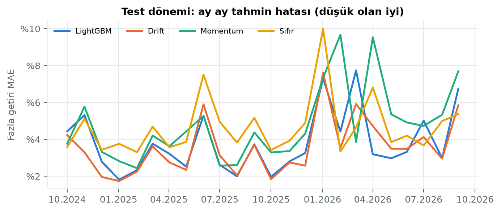

# 6. Makine Öğrenmesi ile Getiri Tahmini

## 6.1 Amaç

Bu bölümde, TEFAS yatırım fonlarının gelecek bir aylık getirisinin makine öğrenmesi yöntemleriyle tahmin edilip edilemeyeceği incelenmiştir. Çalışmanın amacı yalnızca bir model kurmak değil, kurulan modelin **basit referans yöntemlerden daha iyi olup olmadığını** gelecekten bilgi sızdırmayan bir test düzeneğiyle ölçmek ve sonuca göre platformda neyin gösterileceğine karar vermektir.

## 6.2 Hedef değişkenin seçimi

Tahmin hedefi olarak fon fiyatının kendisi değil, **21 işlem günlük (yaklaşık bir aylık) getiri** seçilmiştir. Bunun üç gerekçesi vardır:

1. **Durağanlık ve karşılaştırılabilirlik.** Fon fiyatları durağan değildir ve ölçekleri çok farklıdır (veri setinde 0,01 TL'nin altından 10.000 TL'nin üstüne kadar). Fiyat düzeyinde kurulan bir modelde "yarın da bugünkü fiyat" tahmini bile yüksek isabet gösterir; bu, modelin bilgi taşıdığı anlamına gelmez. Getiri birimsizdir ve bütün fonlar tek bir modelde ortak bir ölçekte değerlendirilebilir.
2. **Karar ile ilişki.** Yatırımcının sorusu "fon ne kadar kazandırır?" sorusudur; getiri tahmini platformdaki diğer bütün metriklerle aynı birimdedir.
3. **Ufuk.** Daha kısa ufuklarda gürültü sinyali bastırır; daha uzun ufuklarda ise yaklaşık dört yıllık veride bağımsız gözlem sayısı azalır.

Modeller getirinin kendisini değil, **para piyasası (PP) fonlarının medyan getirisine göre fazla getiriyi** öğrenecek şekilde kurulmuştur. Faiz düzeyi bütün fonları birlikte etkiler ve fon özelliklerinden öngörülemez; bu bileşen ayrıca, PP fonlarının son bir yıllık ortalama getirisiyle (drift) tahmin edilmiş ve ham tahmin bu iki parçanın toplamı olarak elde edilmiştir.

## 6.3 Veri

Her ayın ilk işlem günü, o gün fiyatı güncel olan ve en az bir yıllık geçmişi bulunan her fon için bir gözlem oluşturulmuştur: 01.11.2022 – 01.09.2026 arasında 47 başlangıç günü, **910 fon, 28.286 gözlem**. Hedef değişkenin dağılımı iki önemli özellik göstermektedir:

- Gözlemlerin **%79,3'ünde** bir aylık getiri pozitiftir; yalnızca %38,4'ünde getiri PP medyanının üzerindedir. Bu nedenle getirinin işaretini doğru tahmin etme oranı yanıltıcı bir ölçüttür: her zaman "artar" diyen bir tahminci bile yaklaşık %79 isabet alır.
- Oynaklık risk değerine göre çok farklıdır: aylık getirinin standart sapması risk değeri 1–2 olan fonlarda %1,1, 3–4 olanlarda %3,3, 5–7 olanlarda %8,9'dur. Bu nedenle bütün metrikler risk grubu bazında ayrıca raporlanmıştır.

Özellikler yalnızca tahmin günü ve öncesindeki fiyatlardan hesaplanmıştır: 1, 3, 6 ve 12 aylık getiriler; 3 ve 12 aylık volatilite; 12 aylık maksimum düşüş; 12 aylık zirveye uzaklık; getirinin o gün bütün fonlar arasındaki yüzdelik sırası (1 ve 12 aylık); kategori; TEFAS risk değeri; PP fonlarının 1 ve 12 aylık medyan getirisi.

## 6.4 Yöntemler

**Referans yöntemler.** (i) Sıfır getiri; (ii) *drift*: fonun son bir yıllık getirisinin aylık karşılığının sürmesi; (iii) *momentum*: son bir ayın getirisinin aynen tekrarlanması. Bir modelin başarılı sayılması için yalnızca sıfır getiriyi değil, **en iyi referansı** geçmesi gerekir.

**ARIMA** [24]**.** Fon bazında, günlük log getiriler (son iki yıl) üzerinde ARIMA(p,0,q), p,q ∈ {0,1,2}, sabit terimli; 21 adımlık tahminlerin toplamı aylık getiriye çevrilmiştir. Mertebe, her fon için ilk test ayından önce AIC ile bir kez seçilmiş, sonra her ay yeniden kestirilmiştir (statsmodels [25]). Hesaplama maliyeti nedeniyle her risk grubundan 10 fon olmak üzere 40 fonluk tabakalı bir örnek kullanılmıştır. Prophet, tatil ve haftalık/yıllık mevsimsellik gibi iş verilerine özgü yapılar için tasarlandığından ve fon fiyatlarında bu tür bir yapı bulunmadığından tercih edilmemiştir.

**LightGBM** [26]**.** Bütün fonlarda ortak eğitilen gradient boosting modeli; hedef fazla getiri, kayıp fonksiyonu mutlak hata (L1). Eğitimde hedefin uç değerleri %0,5–99,5 dilimlerine kırpılmıştır. Hiperparametreler, aşağıda tanımlanan ayar döneminde 12 aday arasından seçilmiştir (`num_leaves`=15, `min_child_samples`=100, 150 ağaç, öğrenme oranı 0,03).

## 6.5 Değerlendirme düzeneği

**Walk-forward test.** Her test ayının ilk işlem günü model, hedef penceresi o günden *önce* biten bütün gözlemlerle yeniden eğitilmiş (genişleyen pencere) ve o günkü fonlar için tahmin üretmiştir. Böylece hiçbir tahmin, kendi gerçekleşmesinden ya da tahmin gününden sonraki bir fiyattan bilgi almaz. Sızıntıya karşı ayrıca şu önlemler alınmıştır: tek günlük hatalı fiyat temizliği ertesi güne baktığı için tahmin gününün kendi fiyatında temizlenmemiş değer kullanılmış; güven aralıkları yalnızca gerçekleşmiş geçmiş hatalarla kurulmuş; tahmin gününde fiyatı olan bütün fonlar (sonradan SPK kararıyla kapatılanlar dahil) teste alınmıştır. Bu kuralların her biri birim testleriyle doğrulanmıştır.

**Takvim.** Ayar dönemi: 10.2023 – 09.2024 (12 ay); hiperparametre seçimi yalnızca burada yapılmıştır. Test dönemi: 10.2024 – 09.2026 (24 ay, 17.261 tahmin); ayar sırasında kullanılmamıştır.

**Metrikler.** Ortalama mutlak hata (MAE) ve karekök ortalama kare hata (RMSE), hem ham getiri hem fazla getiri üzerinden; yön doğruluğu iki biçimde (getirinin işareti ve fonun PP medyanının üstünde mi altında mı kalacağı); ay içi sıralama korelasyonu (Spearman); her ay tahmini en yüksek 10 fonun gerçekleşen ortalama getirisi ("ilk 10"); %80 güven aralığının kapsama oranı.

**Başarı ölçütü** (sonuçlar görülmeden önce tanımlanmıştır): Model, bir risk grubunda o grubun en iyi referansına göre **hem** daha düşük fazla getiri MAE'si **hem** daha yüksek "ilk 10" getirisi sağlarsa o grupta başarılı sayılır.

## 6.6 Bulgular

**Tablo 6.1** Test dönemi genel sonuçlar (24 ay, 17.261 tahmin)

| Model | Fazla getiri MAE | Fazla getiri RMSE | PP üstü/altı yönü | Sıralama korelasyonu | İlk 10 (aylık ort.) | %80 aralık kapsamı |
|---|---|---|---|---|---|---|
| Drift | **%3,65** | **%7,31** | %64,5 | **0,155** | %4,10 | %77,0 |
| LightGBM | %3,88 | %7,46 | %59,6 | 0,054 | **%7,57** | %75,1 |
| Sıfır getiri | %4,70 | %7,67 | %66,5 | – | – | %76,6 |
| Momentum | %4,91 | %9,44 | %59,6 | 0,140 | %7,37 | %75,8 |

Aynı aylarda bütün fonların ortalama aylık getirisi %2,61, PP medyanı %3,54'tür.

**Tablo 6.2** Başarı ölçütü (her grupta en iyi referans drift'tir)

| Risk grubu | Tahmin | LightGBM / drift fazla MAE | LightGBM / drift ilk 10 | LightGBM'in daha iyi olduğu ay | Sonuç |
|---|---|---|---|---|---|
| 1–2 | 2.911 | %0,40 / %0,32 | %3,44 / %3,64 | 4 / 24 | Başarısız |
| 3–4 | 2.163 | %2,21 / %1,97 | %2,81 / %3,15 | 7 / 24 | Başarısız |
| 5–7 | 9.997 | %5,59 / %5,32 | %7,58 / %4,51 | 9 / 24 | Başarısız |
| Risk değeri yok | 2.190 | %2,34 / %2,14 | %1,98 / %2,66 | 8 / 24 | Başarısız |

**ARIMA.** 40 fonluk örnekte ARIMA'nın fazla getiri MAE'si %2,32, aynı fonlarda drift'inki %2,33, LightGBM'inki %2,56'dır; sıralama korelasyonu ARIMA'da 0,210, drift'te 0,185'tir. Seçilen mertebelerin çoğu çok düşük derecelidir (6 fonda (0,0,0), 9 fonda (0,0,1), 7 fonda (1,0,0)). ARIMA'nın drift'ten pratikte ayırt edilememesi, fon getirilerinde kısa vadeli, doğrusal ve öngörülebilir bir yapının neredeyse bulunmadığını göstermektedir.

**Değerlendirme.**

1. **En iyi tahminci en basit yöntemdir.** Drift, genel sonuçta ve dört risk grubunun hepsinde en düşük hatayı ve en yüksek sıralama korelasyonunu vermiştir. LightGBM önceden tanımlanan ölçütü hiçbir grupta karşılayamamıştır.
2. **LightGBM fonları birbirinden ayırt etmeyi öğrenememiştir.** Ay içi sıralama korelasyonu 0,054'tür. Son test ayında eğitilen modelde en önemli iki özellik PP fonlarının 12 ve 1 aylık getirileridir (kazanç payı %25,0 ve %16,2); bu özellikler aynı ay içinde bütün fonlar için aynı değeri alır. Model, fonlar arasındaki farktan çok "bu ay fonlar genel olarak PP'yi ne kadar geçer" sorusunu öğrenmeye çalışmış; bu da sıralama performansını düşürmüştür.
3. **Riskli fonlarda "ilk 10" sonucu güvenilir bir sinyal değildir.** Risk 5–7 grubunda LightGBM'in seçtiği ilk 10 fon aylık ortalama %7,58 kazandırmış, ancak aynı sonuca momentum da yaklaşmıştır (%7,74) ve aylık sonuçlar çok dağınıktır. Eylül 2026'da drift'in seçtiği ilk 10 fonun 7'si, 17.09.2026'da SPK kararıyla işleme kapatılan şirketlere aittir ve bu fonların bir kısmı aynı ay içinde %92–98 değer kaybetmiştir (seçim gününde bu bilinemezdi). 24 aylık, tek bir faiz dönemini kapsayan bir testte bu büyüklükteki farklar istatistiksel olarak anlamlı kabul edilemez.
4. **Güven aralıkları makul ölçüde kalibredir.** %80 hedefe karşı test dönemindeki kapsama %75–77 düzeyindedir.

## 6.7 Keşif amaçlı ek analiz (test sonuçları görüldükten sonra)

> Bu bölümdeki varyant, test sonuçları görüldükten **sonra** tanımlanmıştır. Bu nedenle sonuçları iyimser kabul edilmeli ve ana bulgu olarak yorumlanmamalıdır. Sonuç ne olursa olsun platformdaki karar değiştirilmemiştir.

Bölüm 6.6'daki ikinci bulgudan hareketle tek bir varyant önceden tanımlanmış ve denenmiştir: hedef, fonun **aynı ay içindeki fazla getiri yüzdelik sırası** olarak değiştirilmiş; ay içinde bütün fonlar için aynı olan iki özellik (PP'nin 1 ve 12 aylık getirisi) çıkarılmıştır. Hiperparametreler yeniden ayarlanmamış, asıl modelinkiler kullanılmıştır. Sıra tahmini, hata hesaplanabilsin diye son eğitim ayının fazla getiri dağılımının ilgili dilimine çevrilmiştir; bu varyant için asıl ölçüt sıralama korelasyonu ve "ilk 10"dur.

| Model | Fazla getiri MAE | PP üstü/altı yönü | Sıralama korelasyonu | İlk 10 (aylık ort.) |
|---|---|---|---|---|
| Drift | %3,65 | %64,5 | 0,155 | %4,10 |
| LightGBM (asıl) | %3,88 | %59,6 | 0,054 | %7,57 |
| LightGBM, ay içi sıra hedefi (keşif) | %4,06 | %60,2 | 0,109 | %6,97 |

Sıra hedefi, sıralama korelasyonunu 0,054'ten 0,109'a çıkarmıştır; yani modelin fonları birbirinden ayırt etme yeteneği iyileşmiştir. Ancak drift'in 0,155'lik korelasyonuna ulaşılamamış, hata ve "ilk 10" açısından da asıl modele göre bir kazanım elde edilmemiştir. Bu varyantta en önemli özellikler fonun kendi geçmiş getirileridir (1 aylık %14,4, 6 aylık %13,0, 12 aylık sıra %12,4); bu da modelin, drift'in zaten kullandığı bilgiyi daha gürültülü biçimde öğrendiğini düşündürmektedir.

## 6.8 LSTM'in kapsam dışı bırakılma gerekçesi

Planlama aşamasında LSTM (uzun kısa süreli bellek) ağları opsiyonel olarak ele alınmış ve aşağıdaki gerekçelerle bu çalışmanın kapsamı dışında bırakılmıştır:

1. **Veri yapısı.** Veri seti, en fazla yaklaşık 1.250 günlük (TEFAS'ın verdiği 5 yıl) yaklaşık bin zaman serisinden oluşmaktadır. Aylık örneklemeyle bağımsız gözlem sayısı fon başına 47'yi geçmez. Derin öğrenme modellerinin genelleme yapabilmesi için gereken veri miktarı bunun çok üzerindedir; orta büyüklükteki tablo biçimli verilerde ağaç tabanlı yöntemlerin derin öğrenme modellerine genellikle eşit ya da üstün sonuç verdiği gösterilmiştir [27].
2. **Sinyalin zayıflığı.** ARIMA'nın drift'ten ayırt edilememesi ve LightGBM'in referansı geçememesi, fon getirilerinde öğrenilebilir kısa vadeli yapının çok zayıf olduğunu göstermiştir. Aynı geçmiş getiri dizilerini girdi olarak kullanacak bir LSTM'in, bu yapıyı ortaya çıkarması için ek bir gerekçe yoktur; daha esnek bir model, zayıf sinyal altında gürültüye uyum sağlama (aşırı öğrenme) riskini artırır.
3. **Önceden belirlenen karar kuralı.** Plan aşamasında, LSTM'e ancak LightGBM anlamlı bir sinyal gösterirse dönülmesi kararlaştırılmıştı. LightGBM önceden tanımlanan başarı ölçütünü hiçbir risk grubunda karşılayamadığı için bu koşul gerçekleşmemiştir.
4. **Maliyet ve yayın kısıtı.** LSTM için gereken PyTorch kütüphanesi yaklaşık 200 MB'tan büyüktür ve CPU üzerinde eğitim ile hiperparametre ayarı, ARIMA ve LightGBM'in birkaç dakikalık sürelerinin çok üzerindedir. Plan aşamasında öngörülen ücretsiz sunucunun 512 MB belleği de modelin çalıştırılmasını zorlaştıracaktı (uygulama daha sonra yayına alınmama kararıyla yerelde çalıştırılmaktadır).
5. **Zaman.** Kalan iş paketleri (kullanıcı testi, rapor ve sunum) göz önüne alındığında, olumlu sonuç verme olasılığı düşük bir modele ayrılacak yaklaşık iki çalışma oturumunun bu paketlere ayrılması tercih edilmiştir.

LSTM, daha uzun bir veri dönemi (birden fazla faiz rejimi) ya da fon portföy içeriği gibi ek bilgi kaynakları elde edildiğinde yeniden değerlendirilebilecek bir gelecek çalışma olarak bırakılmıştır.

## 6.9 Platformdaki uygulama

Önceden belirlenen karar kuralı gereği, başarı ölçütünü karşılayamayan LightGBM'in tahminleri platformda gösterilmemiştir. Bunun yerine fon detay sayfasında, testlerde en isabetli çıkan yöntem olan drift'e dayalı **"geçmiş eğilime dayalı tahmin"** gösterilmektedir:

- Tahmin: fonun son bir yıllık getirisinin aylık karşılığı.
- %80 aralık: drift'in aynı risk grubundaki geçmiş hatalarının %10 ve %90 dilimleri (konformal yöntem [28], [29]). Aralığın test dönemindeki kapsama oranı kullanıcıya gösterilmektedir: risk 1–2 grubunda %73,4, 3–4'te %75,0, 5–7'de %75,7, risk değeri bulunmayan fonlarda %82,6.
- Etiket: "Bu bir ML tahmini değildir; testlerde en isabetli yöntem fonun geçmiş ortalama getirisinin sürmesi varsayımı çıktı."
- Fiyat grafiğinde bir aylık tahmin konisi ve tutara göre beklenen değer ile aralığı TL olarak gösteren bir hesaplayıcı; öneri sayfasında örnek portföy için aynı hesabı yapan bir planlayıcı. Her ikisinde "eğitim amaçlı örnek dağılımdır, yatırım tavsiyesi değildir" uyarısı yer almaktadır.
- "Model performansı" sayfasında, başarısız olanlar dahil bütün sonuçlar ve keşif analizi ayrı olarak yayımlanmaktadır.

Tahminler her gece, değerlendirme raporu ise ayda bir otomatik olarak yenilenmektedir (gece işi yaklaşık 10 saniye; aylık rapor yaklaşık 20 saniye ek süre).

## 6.10 Sınırlamalar

- Test dönemi yaklaşık iki yıldır ve tek bir yüksek faiz ortamını kapsar; sonuçlar başka piyasa koşullarına genellenemez.
- 24 aylık test, model ile referans arasındaki küçük farkların istatistiksel olarak ayırt edilmesi için kısadır.
- Fonların kategori ve risk değeri için yalnızca güncel değerlere erişilebilmiştir; geçmiş tarihlerdeki tahminlerde de güncel değerler kullanılmıştır.
- ARIMA, hesaplama maliyeti nedeniyle 40 fonluk bir örnekte değerlendirilmiştir.
- Eylül 2026'daki SPK kararıyla kapatılan fonların sert değer kayıpları test dönemine dahildir; bu, yöntemin gerçek riskleri dışlamadan test edildiğini gösterirken sonuçların o aya duyarlı olmasına da yol açar.

## 6.11 Sonuç

Bir aylık fon getirisini tahmin etmek için kurulan LightGBM modeli, gelecekten bilgi sızdırmayan walk-forward bir testte fonun geçmiş ortalama getirisinin sürmesini varsayan basit drift yöntemini hiçbir risk grubunda geçememiştir; fon bazında ARIMA ise drift ile pratikte aynı sonucu vermiştir. Bu bulgu, kısa vadeli fon getirilerinin büyük ölçüde öngörülemez olduğu yönündeki genel kabulle tutarlıdır. Çalışmanın katkısı, bir modelin yalnızca kurulmasıyla değil, önceden tanımlanmış bir ölçüte göre test edilmesiyle değerlendirilmesi ve sonucun —olumsuz da olsa— kullanıcıya şeffaf biçimde yansıtılmasıdır: platform, testte en isabetli çıkan yöntemi açık bir etiketle ve ölçülmüş kapsama oranına sahip bir aralıkla göstermekte, makine öğrenmesi modellerinin sonuçlarını ise ayrı bir sayfada bütünüyle yayımlamaktadır.
