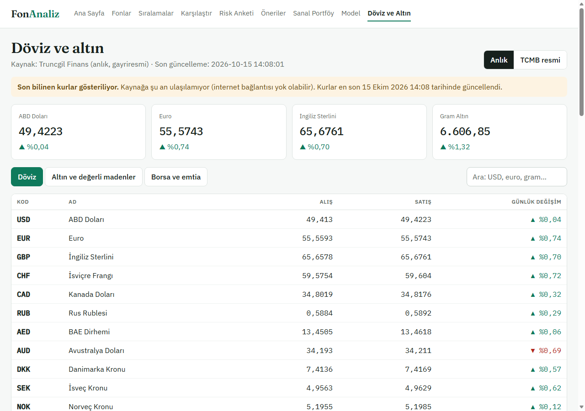

# 7. Test ve Demo

> Kullanıcı testinin sonuçları (7.5), demo videosunun bağlantısı (7.6) ve sunum bilgisayarındaki Wi-Fi denemesi (7.4) yapıldıktan sonra doldurulacaktır.

## 7.1 Amaç

Bu aşamada uygulamanın uçtan uca doğru çalıştığını göstermeyi, sunumda kendi bilgisayarımızda ve gerekirse internet bağlantısı olmadan güvenilir biçimde çalıştırılmasını sağlamayı ve gerçek kullanıcılardan geri bildirim almayı amaçlıyoruz.

## 7.2 Otomatik testler

Backend'de 131 otomatik test bulunmaktadır (Bölüm 3.7; 15.10.2026). Ön yüz her değişiklikten sonra `npm run lint` ve `npm run build` ile denetlenmiştir.

**Tablo 7.1** Test dosyalarına göre otomatik testler

| Dosya | Kapsam | Test |
|---|---|---|
| `test_funds_api.py` | Fon listesi, detay, fiyat, teknik gösterge, büyüklük API'leri | 23 |
| `test_sanal_portfoy.py` | Sanal portföy ve "Ya o zaman alsaydım?" | 18 |
| `test_recommender.py` | Öneri puanı, portföy, geriye dönük test | 17 |
| `test_sources.py` | TEFAS, TCMB ve anlık kur ayrıştırıcıları; internetsiz döviz (son bilinen kurlar) | 11 |
| `test_risk_survey.py` | Risk anketi ve profil | 10 |
| `test_ml.py` | ML özellikleri, modeller, değerlendirme | 9 |
| `test_metrics.py` | Getiri, volatilite, Sharpe, maksimum düşüş | 8 |
| `test_updater.py` | Gece güncellemesi, büyüklük ve profil; internet yokken atlama, bağlantı kopunca durma | 9 |
| `test_yedek.py` | Yedek alma, geri yükleme, güvenlik kopyası, geçersiz yedeğin reddi | 3 |
| `test_technical.py` | Hareketli ortalama, trend, 52 haftalık aralık | 7 |
| `test_models.py` | Veritabanı tabloları | 5 |
| `test_data_quality.py` | Tek günlük fiyat sıçramaları | 4 |
| `test_ml_job.py` | Gece tahmin işi | 3 |
| `test_fund_status.py` | SPK kararıyla kapatılan fonlar | 3 |
| `test_api.py` | Sağlık kontrolü | 1 |
| **Toplam** | | **131** |

## 7.3 Uçtan uca test

**Yöntem.** Uçtan uca testi elle tıklamak yerine tekrarlanabilir bir betikle yaptık (`frontend/scripts/uctan_uca.mjs`). Betik, Edge'i görünmez (headless) modda açıp geliştirici protokolüyle sürer. Gerçek veritabanıyla çalışan uygulamada her sayfayı açar, bir kullanıcı gibi düğmelere tıklar, kutulara yazar ve sonucu denetler. Testler dört turda çalışır: açık ve koyu tema, 1280 px masaüstü ve 390 px telefon genişliği. Her sayfada ayrıca şunlar kaydedilir:

- konsoldaki hata mesajları ve yakalanmamış JavaScript hataları,
- 500 ve üstü kodla dönen API istekleri,
- localhost dışına giden her istek (internetsiz çalışmanın kanıtı),
- yatay taşma (sayfa genişliğinin ekran genişliğini aşması).

Sanal portföy akışı gerçek bir alış emri verip iptal eder. Portföy boşsa test sonunda aynı başlangıç bakiyesiyle yeniden boşaltılır; portföyde gerçek kayıt varsa bu adımlar atlanır, hiçbir şey silinmez.

**Kontrol listesi.**

**Tablo 7.2** Uçtan uca test kontrol listesi (her satır dört turda denenir)

| Sayfa / akış | Denetlenenler |
|---|---|
| Ana sayfa | Başlık, kategori kutuları (9), öne çıkan 8 fon, risk anketi kartı; "altın" araması fon listesini süzülmüş açar |
| Fon listesi | 25 satır; "Büyüklük" sütununa göre sıralama (ilk satır milyar TL); sonraki sayfa |
| Fon detayı ve teknik göstergeler | Fiyat grafiği; 50 ve 200 günlük ortalama çizgileri açılır; trend etiketi ve 52 haftalık aralık; dönem 3Y; tahmin kartı ve hesaplayıcı; fon büyüklüğü ve yatırımcı sayısı; KAP bağlantısı kap.org.tr'ye gider; "Sanal portföyde dene" bağlantısı |
| Karşılaştırma | 4 fon çizgisi, metrik tablosu (10+ satır), logaritmik ölçek |
| Sıralamalar | 3 liste, her birinde 10 fon |
| Risk anketi | 9 soru ekrandaki düğmelerle yanıtlanır, profil kartı çıkar |
| Öneriler ve portföy planlayıcı | 10 öneri kartı, örnek portföy grafiği, planlayıcıda tutar 50.000 TL yapılınca toplam güncellenir, kayan pencereli test grafiği |
| Sanal portföy | Simülasyon uyarısı; fon arama ve seçim (valör bilgisi görünür); 5.000 TL alış emri; emir bekleyenlerde ve nakit "ayrılan" olarak görünür; emir iptal edilir; işlem geçmişi |
| Ya o zaman alsaydım? | Bağlantıyla gelen 2 fonun sonucu ve grafik; tarih 03.10.2022 yapılıp yeniden hesaplanınca alış günü 2022 olur ve yıllıklandırılmış getiri görünür |
| Döviz ve altın | Anlık kur tablosu, TCMB sekmesi; çevrimdışında "Son bilinen kurlar … en son X tarihinde güncellendi" notu |
| Model performansı | Sonuç tabloları (3+), aylık hata grafiği |
| Her sayfada | Yatay taşma yok; konsol ve sayfa hatası yok; 5xx dönen API isteği yok; localhost dışına istek yok |

**Sonuçlar (15.10.2026).**

| Koşul | Açık, 1280 px | Koyu, 1280 px | Açık, 390 px | Koyu, 390 px | Toplam |
|---|---|---|---|---|---|
| İnternet var | 51/51 | 51/51 | 51/51 | 51/51 | 204/204 |
| İnternet yok (Bölüm 7.4) | 52/52 | 52/52 | 52/52 | 52/52 | 208/208 |

Bütün turlarda konsol hatası, sayfa hatası, 5xx yanıtı ve dış istek kaydedilmedi. Çevrimdışı turda bir adım fazladır: "son bilinen kurlar" notunun görünmesi.

Betikle bulunan ve düzeltilen hatalar Bölüm 7.7'dedir. Otomatik denetim görsel kusurları yakalamadığı için ekran görüntülerini (`docs/rapor/gorseller/tasarim/`) ayrıca gözle inceledik.

```powershell
cd frontend
node scripts/uctan_uca.mjs                # 4 tur, internet var
node scripts/uctan_uca.mjs --cevrimdisi   # tarayıcının dış ağı kapalı
```

## 7.4 Yerel çalıştırma ve sunum hazırlığı

Uygulamayı yayına almama, sunumda geliştiricinin bilgisayarında çalıştırma kararı aldık. Bu karar doğrultusunda üç hazırlık yaptık.

**Tek tıkla başlatma.** Proje kökündeki `FonAnaliz_Baslat.bat`:

1. Sanal ortamın, `node_modules` klasörünün ve veritabanının varlığını kontrol eder. Eksik olan varsa ne yapılacağını yazar.
2. Backend'i (FastAPI, port 8000) ve frontend'i (Vite, port 5173) simge durumunda küçültülmüş iki pencerede başlatır. Biri zaten çalışıyorsa yeniden başlatmaz.
3. İkisi de yanıt verene kadar en çok 2 dakika bekler, sonra tarayıcıda siteyi açar.

Denemede site 13 saniyede açıldı. `FonAnaliz_Durdur.bat`, 8000 ve 5173 portlarını dinleyen işlemleri ve pencerelerini kapatır. Eski dört başlatma dosyası (backend, frontend, tüm fonları yükleme, terminal) bu ikisiyle değiştirildi; ilk veri yüklemesi artık komutla yapılır, eksik günleri ise backend açılışta zaten tamamlar.

**İnternetsiz çalışma.**

- *Döviz:* TCMB ve Truncgil'in son başarılı yanıtı veritabanına yazılır (`fx_snapshots`). Kaynağa ulaşılamazsa döviz sayfası bu kurları "Son bilinen kurlar gösteriliyor … Kurlar en son 15 Ekim 2026 14:08 tarihinde güncellendi" notuyla gösterir (Şekil 7.1). Önceden kurlar yalnızca bellekte tutuluyordu; backend internetsiz açıldığında döviz sayfası hata veriyordu.
- *Gece güncellemesi ve açılıştaki tamamlama:* Başlamadan önce TEFAS'a 3 saniyelik bir bağlantı denemesi yapılır. Bağlantı yoksa güncelleme hiçbir şeye dokunmadan "offline" durumuyla atlanır ve ana sayfada "İnternet bağlantısı yok: güncelleme atlandı" yazar. Denemede atlama 4 saniye sürdü. Güncelleme sırasında bağlantı koparsa, art arda 3 hatadan sonra bağlantı yeniden denetlenir; bağlantı yoksa güncelleme durur ve o ana kadar alınan veriler kalır.
- *Yazı tipleri:* Projeye gömülüdür (Bölüm 4.3); sayfalar dışarıdan hiçbir dosya yüklemez. Bunu uçtan uca testteki "dış istek" kaydı doğrular.

İnternet kesintisini, bilgisayarın bağlantısını gerçekten kesmek yerine şöyle canlandırdık:

- Backend'i ulaşılamayan bir proxy adresiyle (`HTTPS_PROXY=http://127.0.0.1:9`) başlattık. Böylece TEFAS, TCMB ve Truncgil istekleri gerçek bir "bağlantı reddedildi" hatası aldı.
- Tarayıcıyı da aynı proxy ile açtık; localhost bu kuraldan muaf tutuldu.
- Bütün sayfalar dört turda sorunsuz çalıştı (Bölüm 7.3).

[DOLDUR: sunum bilgisayarında Wi-Fi gerçekten kapatılarak bir kez daha denenecek.]



**Yedek ve geri yükleme.**

- `python -m scripts.yedekle` veritabanının tarihli bir kopyasını proje kökündeki `backups/` klasörüne alır (ör. `fon_2026-10-15_142530.db`; `--not sunum-oncesi` ile dosya adına not eklenir).
- Kopya SQLite'ın çevrim içi yedekleme API'siyle alınır; backend çalışırken de tutarlıdır. Alındıktan sonra bütünlük denetiminden geçirilir.
- Veritabanı tek dosya olduğu için fon verisi, metrikler, tahminler, sanal portföy ve son bilinen kurlar birlikte yedeklenir.
- `python -m scripts.geri_yukle` en son yedeği, `python -m scripts.geri_yukle <dosya>` seçilen yedeği geri yükler; `--liste` yedekleri listeler.
- Geri yüklemeden önce mevcut veritabanının güvenlik kopyası alınır (`geri_yukleme_oncesi_*.db`). Geçersiz ya da başka bir projeye ait dosya reddedilir. Backend çalışıyorsa önce durdurulması istenir.
- `backups/` git'e girmez. Gerçek veritabanıyla denemede yedek 85 MB tuttu ve geri yükleme sonrası 1.071 fon ile son fiyat günü korundu.

## 7.5 Kullanıcı testi

Kullanıcı testi için yazdırılabilir bir senaryo hazırladık (`docs/kullanici_testi.md`). Senaryo 6 görevden oluşur: fon arama ve detay, iki fonu karşılaştırma, risk anketi ve öneriler, sanal portföyde fon alma, "Ya o zaman alsaydım?" ve döviz sayfası. Her görevde başarı ölçütü, süre ve gözlem alanı vardır. Sonda 1–5 puanlık 5 soruluk kısa bir anket bulunur.

[DOLDUR: Katılımcı sayısı (hedef 3–5), görevlerin tamamlanma oranı ve süreleri, anket puanlarının ortalaması, öne çıkan gözlemler ve yapılan düzeltmeler.]

## 7.6 Demo

Canlı demo bozulursa kullanılmak üzere 4 dakikalık bir demo videosunun senaryosunu hazırladık (`docs/demo_senaryosu.md`). Senaryo, her adımda hangi ekranın gösterileceğini ve söylenecek 1–2 cümleyi saniye aralıklarıyla verir: açılış ve ana sayfa, fon detayı ve teknik göstergeler, karşılaştırma, risk anketi ve öneriler, sanal portföy, "Ya o zaman alsaydım?", model performansı ve kapanış.

[DOLDUR: demo videosunun bağlantısı ve prova notları.]

## 7.7 Karşılaşılan sorunlar ve çözümleri

| Sorun | Neden | Çözüm |
|---|---|---|
| Güncelleme sırasında internet koparsa güncelleme saatlerce sürecekti | Her fon için 3 deneme ve artan bekleme (2 + 4 + 8 sn); yaklaşık 1.000 fonda yaklaşık 4 saat | Art arda 3 hatadan sonra bağlantı denetlenir, bağlantı yoksa güncelleme durur (testle doğrulandı) |
| Backend internetsiz açıldığında döviz sayfası hata veriyordu | Son kurlar yalnızca bellekte tutuluyordu | Son başarılı yanıt veritabanına yazılıyor (`fx_snapshots`) |
| Mevcut döviz testleri gerçek veritabanına yazabilirdi | Testler `TestClient(app)`'i veritabanını geçersiz kılmadan kullanıyordu; kurları saklama eklenince sahte kurlar `fon.db`'ye girecekti | Testler bellek içi veritabanına taşındı |
| Uçtan uca testin ilk çevrimdışı denemesinde sayfalar hiç açılmadı | Tarayıcı ayarı (`<-loopback>`) localhost'u da kapalı proxy'ye yönlendiriyordu | localhost proxy'den açıkça muaf tutuldu |
| "Ya o zaman alsaydım?" testinde yeni tarih denenmeden adım geçiyordu | Koşul, eski sonuçta da bulunan "%" işaretine bakıyordu | Adım, alış gününün gerçekten seçilen yıla dönmesini bekliyor |
| Başlatma dosyası etkileşimsiz pencerede hata veriyordu | `timeout` komutu klavye girişi istiyor | Bekleme `ping` ile yapılıyor |

## 7.8 Kısıtlar

- İnternet kesintisi proxy ile canlandırıldı; Wi-Fi kapatılarak yapılacak deneme sunum bilgisayarında yapılacak.
- Başlatma dosyaları Windows içindir. Sanal ortamın ve `node_modules`'ün bir kez, internet varken kurulmuş olması gerekir.
- Uçtan uca test yalnızca Edge (Chromium) ile yapıldı; Firefox ve Safari denenmedi.
- Ekran okuyucuyla deneme yapılmadı (Bölüm 4.8).
